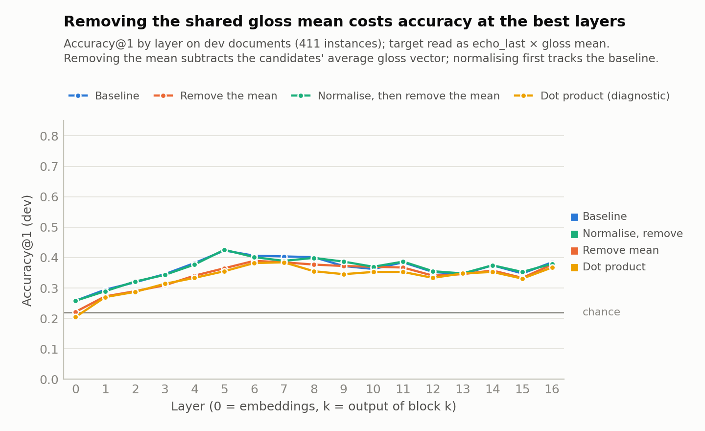
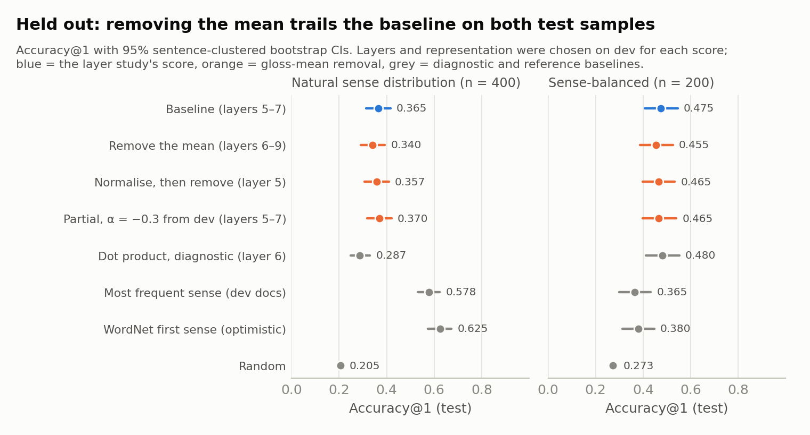
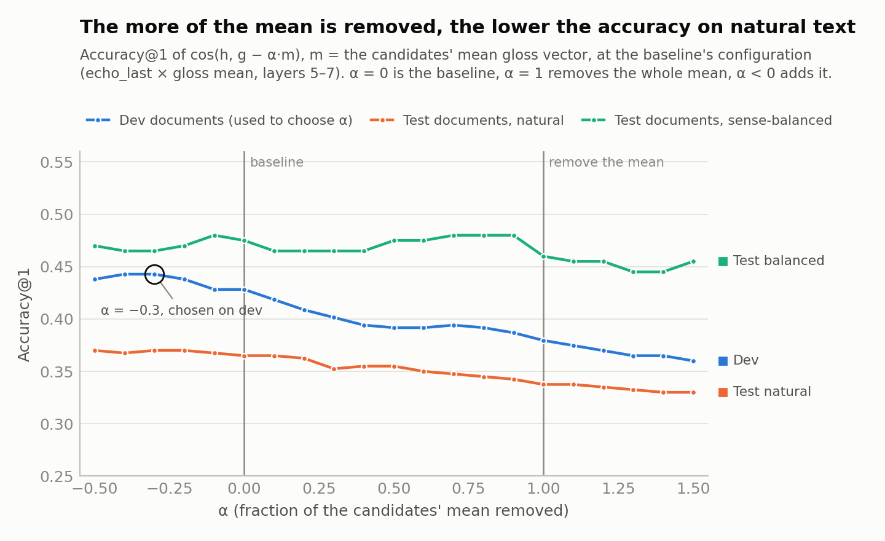

# Does removing what a word's glosses share sharpen gloss matching?

> This follows on from [`SWAP_STUDY.md`](SWAP_STUDY.md), whose next step 2 it tests, and was written on 7 November
> 2026. It asks whether subtracting the mean of a target's candidate gloss vectors before the cosine improves gloss
> matching. The data, layers, centring and protocol are the layer study's: every choice is made on **dev
> documents**, and the frozen choices are scored once on **held-out test documents**. No new extraction was
> needed. All numbers come from [`Analysis/gloss_mean_study.py`](../Analysis/gloss_mean_study.py), with the raw
> output in [`gloss_mean_study/results.json`](gloss_mean_study/results.json). The maths is worked through, with
> examples, in [`Analysis/gloss_mean_methods.ipynb`](../Analysis/gloss_mean_methods.ipynb).

## Summary

**The idea.** Every definition prompt starts with the word itself, as in *"plant: buildings for carrying on
industrial labor"*. So the gloss vectors of a word's candidate senses share a component: the lemma, and the shape
of a definition. Subtracting the candidates' mean gloss vector $m$ before the cosine should leave only what tells
the senses apart. Three versions were tested:

1. **Remove the mean:** $\cos(h,\ g_k - m)$. This is the primary test.
2. **Normalise, then remove the mean:** $\cos(h,\ \hat g_k - \hat m)$, with $\hat m$ the mean of the unit gloss
   vectors.
3. **Partial removal:** $\cos(h,\ g_k - \alpha m)$, with α tuned on dev.

The score-level version, $\cos(h, g_k)$ minus the candidates' average cosine, shifts every candidate by the same
amount, so it can never change a ranking.

**Result: it doesn't help.** On held-out test documents, with each score's layers and representation chosen on dev:

| Test sample | Baseline (layer study) | Remove the mean | Normalise, then remove | Partial removal, α = −0.3 |
|---|---:|---:|---:|---:|
| Natural sense distribution (400 instances) | **0.365** [0.313, 0.416] | 0.340 [0.291, 0.392] | 0.357 [0.306, 0.410] | 0.370 [0.319, 0.421] |
| Sense-balanced (200 instances) | **0.475** [0.408, 0.545] | 0.455 [0.387, 0.525] | 0.465 [0.398, 0.533] | 0.465 [0.397, 0.540] |

Accuracy@1 with 95% sentence-clustered bootstrap CIs. Chance is 0.205 (natural) and 0.273 (balanced).

- **Removing the mean costs a little on natural text:** −0.025 (p = 0.11), or −0.028 (p = 0.047) at the
  baseline's own layers. On balanced text it is −0.020 (p = 0.50).
- **Normalising first changes almost nothing.** At the baseline's layers it alters 3–7% of picks and scores 0.362
  and 0.475.
- **The more of the mean is removed, the lower natural-text accuracy.** On dev it falls from 0.428 with none
  removed to 0.380 with all of it. The α chosen on dev, −0.3, actually *adds* some of the mean. On test that gains
  0.005 on natural text (p = 0.58) and loses 0.010 on balanced text (p = 0.52).

**Why it doesn't help.**
- **Only the length correction changes.** The mean adds the same amount to every candidate's dot product with the
  target, so subtracting it can only change how each score is divided by the length of its gloss vector
  ([§2.1](#21-scores-and-how-they-relate)).
- **The shared part is large.** At layers 5–7 each centred gloss vector has cosine 0.63 with its candidates' mean,
  and removing the mean leaves 76–77% of its length.
- **Through the cosine, the shared part favours wordy definitions.** A gloss vector is the mean over the gloss's
  tokens, so the more words, the shorter the vector (Spearman −0.74 across 2,378 dev glosses). The shared part's
  contribution to the cosine is divided by that length, so it is worth most to the wordiest definitions.
- **On natural text, wordy definitions are often right** (an exploratory check). There the gold gloss is wordier
  than its rivals (word-count rank 0.56–0.58, where 0.5 is typical), because WordNet's first, most frequent, sense
  tends to have the fullest definition. On balanced text the gold is typical (0.49–0.50).

So removing the mean takes away a weak frequency proxy. Its picks are terser definitions (word-count rank
0.38–0.40, against the baseline's 0.48–0.49 on natural text), and natural-text accuracy drops. The dot product,
which doesn't divide by the length at all, goes further in the same direction and loses 0.040 at the baseline's
layers (p = 0.005).

**What this means.** A word's gloss vectors do share a lot, but the shared part isn't what misleads the matching.
The swap study found the same on the sentence side, so subtracting shared components looks like the wrong lever.
What the method lacks is sense frequency. Next steps are in [§3.5](#35-limitations-and-next-steps).

---

## 1. What was built

| File | What it does |
|---|---|
| [`Processing/gloss_contrast.py`](../Processing/gloss_contrast.py) | The scores: the baseline, removing the mean, normalising then removing it, partial removal, and the dot-product diagnostic. |
| [`Analysis/gloss_mean_study.py`](../Analysis/gloss_mean_study.py) | The experiment (protocol in [§2.2](#22-protocol)). It reuses the layer study's vectors and runs in about 4–5 minutes. |
| [`Analysis/gloss_mean_study_figures.py`](../Analysis/gloss_mean_study_figures.py) | The three figures below. |
| [`Analysis/gloss_mean_methods.ipynb`](../Analysis/gloss_mean_methods.ipynb) | The scores documented, with a toy example to check by hand, every identity checked numerically, and real Llama examples. It is generated by [`build_gloss_mean_notebook.py`](../Analysis/build_gloss_mean_notebook.py). |
| [`tests/test_gloss_contrast.py`](../tests/test_gloss_contrast.py) | 9 unit tests, including the notebook's identities. |

## 2. Method

### 2.1 Scores and how they relate

Per layer, with $h$ = the target's vector and $g_k$ = candidate $k$'s gloss vector, both centred with the layer
study's dev means. $m$ is the mean of the target's candidate gloss vectors, and $\hat x$ is a vector scaled to unit
length.

| Score | Formula | Code |
|---|---|---|
| baseline | $\cos(h, g_k)$ | `baseline`, the layer study's score |
| remove the mean | $\cos(h,\ g_k - m)$ | `glossmean` |
| normalise, then remove the mean | $\cos(h,\ \hat g_k - \hat m)$, with $\hat m$ the mean of the $\hat g_j$ | `unitmean` |
| partial removal | $\cos(h,\ g_k - \alpha m)$; α = 0 is the baseline, α = 1 removes the mean | `alpha=…` |
| dot product | $\langle \hat h, g_k\rangle$, divided by the candidates' mean gloss-vector length | `dot`, a diagnostic |

The highest score is predicted, and a band of layers averages the per-layer scores, as in the layer study. Four
facts follow from the algebra. The notebook proves each one and checks it numerically.

1. **Subtracting at the score level does nothing.** $\cos(h, g_k) - \frac1n\sum_j \cos(h, g_j)$ subtracts the same
   number from every candidate.
2. **Removing the mean only changes the length correction.** The score equals
   $\big(\langle \hat h, g_k\rangle - \langle \hat h, m\rangle\big) / \lVert g_k - m\rVert$. The term
   $\langle \hat h, m\rangle$ is the same for every candidate, so the numerator ranks like the dot product. The
   baseline divides by $\lVert g_k\rVert$; removing the mean divides by $\lVert g_k - m\rVert$ instead. Normalising
   first is, likewise, the baseline's margin over the candidates' average cosine, divided by
   $\lVert \hat g_k - \hat m\rVert$. Both always pick a candidate that is above the candidates' average.
3. **Two candidates.** With $n = 2$, $g_1 - m = -(g_2 - m)$. Removing the mean then ranks exactly like the dot
   product, and normalising first ranks exactly like the baseline. Both identities hold for every two-candidate
   target in the data, which are 12.5–18% of each sample ([§3.4](#34-diagnostics-why-it-doesnt-help)).
4. **Other properties.** The gloss centring cancels when the mean is removed, but not when normalising first.
   Subtracting the mean of the *other* candidates only rescales $g_k - m$, so it gives the same cosine.

### 2.2 Protocol

The protocol was fixed in the docstring of [`gloss_mean_study.py`](../Analysis/gloss_mean_study.py) before any
result existed.

1. **Primary.** For each score, the layer study's dev search was repeated on dev_natural: 3 target
   representations × 2 gloss representations × 62 contiguous bands of 1–4 layers, giving 372 configurations
   ranked by accuracy@1. Each score's winner was frozen and scored once on test_natural and test_balanced. Results
   carry cluster-bootstrap CIs and paired comparisons with the frozen baseline. The baseline's search reproduces
   the layer study exactly (*echo_last* × mean gloss, layers 5–7, test accuracy 0.365). The primary question:
   does removing the mean beat the baseline on test?
2. **Secondary,** reported whatever they show: each score at the baseline's configuration, and partial removal
   with α tuned on dev (grid −0.5 to 1.5 in steps of 0.1; ties go to the α nearest 0).
3. **Diagnostics:** how much each gloss vector shares with its candidates' mean; accuracy by layer; accuracy split
   by the number of candidates; how often each score changes the baseline's pick.
4. **Exploratory**, added after the primary result was seen and labelled as such: does a gloss vector's length
   track the gloss's word count, and are the gold gloss and each score's pick wordier than their rivals?

## 3. Results

### 3.1 Dev: profiles and selection



| Score | Selected on dev | Dev acc@1 [95% CI] | Dev acc@1 at the baseline's configuration |
|---|---|---|---:|
| Baseline | echo_last × mean gloss, layers 5–7 | **0.428** [0.376, 0.477] | 0.428 |
| Remove the mean | echo_last × mean gloss, layers 6–9 | 0.406 [0.359, 0.452] | 0.380 |
| Normalise, then remove the mean | echo_last × mean gloss, layer 5 | 0.426 [0.378, 0.466] | 0.404 |
| Dot product (diagnostic) | plain_last × mean gloss, layer 6 | 0.399 [0.346, 0.449] | 0.358 |

Accuracy@1 by layer on dev_natural, with the target read as *echo_last* and glosses as their mean:

| Score | L0 | L2 | L4 | L5 | L6 | L7 | L8 | L10 | L12 | L14 | L16 |
|---|---:|---:|---:|---:|---:|---:|---:|---:|---:|---:|---:|
| Baseline | 0.26 | 0.32 | 0.38 | **0.42** | 0.41 | 0.40 | 0.40 | 0.36 | 0.35 | 0.37 | 0.38 |
| Remove the mean | 0.22 | 0.29 | 0.34 | 0.36 | 0.39 | 0.38 | 0.38 | 0.37 | 0.34 | 0.36 | 0.38 |
| Normalise, then remove | 0.26 | 0.32 | 0.38 | 0.43 | 0.40 | 0.39 | 0.40 | 0.37 | 0.36 | 0.37 | 0.38 |
| Dot product | 0.20 | 0.29 | 0.33 | 0.36 | 0.38 | 0.38 | 0.36 | 0.35 | 0.33 | 0.35 | 0.37 |
| Chance | 0.22 | 0.22 | 0.22 | 0.22 | 0.22 | 0.22 | 0.22 | 0.22 | 0.22 | 0.22 | 0.22 |

- **Removing the mean costs most where the baseline is best:** 0.36 against 0.42 at layer 5. From layer 9 on, the
  two are within 0.02 of each other.
- **Normalising first tracks the baseline** to within 0.02 at every layer. Its own search picks layer 5 alone,
  which scores 0.426 on dev against the baseline's 0.428.
- **The dot product tracks removing the mean or falls below it,** by up to 0.027 (layer 9). It is never more than
  0.005 above it.

### 3.2 Held-out validation



| Score | Natural (400) | vs baseline | Sense-balanced (200) | vs baseline |
|---|---|---|---|---|
| **Baseline** (layer study) | **0.365** [0.313, 0.416] | | **0.475** [0.408, 0.545] | |
| Remove the mean, own selection | 0.340 [0.291, 0.392] | −0.025 [−0.056, +0.005], p = 0.114 | 0.455 [0.387, 0.525] | −0.020 [−0.066, +0.030], p = 0.503 |
| Normalise, then remove, own selection | 0.357 [0.306, 0.410] | −0.007 [−0.040, +0.021], p = 0.660 | 0.465 [0.398, 0.533] | −0.010 [−0.065, +0.041], p = 0.801 |
| Remove the mean at the baseline's layers | 0.338 [0.288, 0.390] | −0.028 [−0.054, −0.002], p = 0.047 | 0.460 [0.395, 0.532] | −0.015 [−0.060, +0.030], p = 0.603 |
| Normalise, then remove, at the baseline's layers | 0.362 [0.311, 0.413] | −0.003 [−0.014, +0.008], p = 0.805 | 0.475 [0.407, 0.547] | +0.000 [−0.020, +0.020], p = 1.000 |
| Partial removal, α = −0.3 (tuned on dev) | 0.370 [0.319, 0.421] | +0.005 [−0.005, +0.019], p = 0.582 | 0.465 [0.397, 0.540] | −0.010 [−0.035, +0.015], p = 0.522 |
| Dot product (diagnostic), own selection | 0.287 [0.249, 0.329] | −0.077 [−0.108, −0.048], p = 0.001 | 0.480 [0.412, 0.552] | +0.005 [−0.045, +0.055], p = 0.956 |
| Dot product at the baseline's layers | 0.325 [0.278, 0.375] | −0.040 [−0.066, −0.014], p = 0.005 | 0.440 [0.375, 0.510] | −0.035 [−0.085, +0.015], p = 0.204 |
| Most frequent sense (dev documents) | 0.578 [0.531, 0.624] | +0.212 | 0.365 [0.299, 0.432] | −0.110 |
| WordNet first sense (optimistic) | 0.625 [0.573, 0.673] | +0.260 | 0.380 [0.313, 0.447] | −0.095 |
| Random | 0.205 [0.191, 0.219] | | 0.273 [0.257, 0.291] | |

Paired differences are cluster-bootstrap estimates (2,000 resamples of sentences). Seven scores were compared with
the baseline on two test samples. Three of the 14 comparisons are below p = 0.05, and all three favour the
baseline: removing the mean at the baseline's layers on natural text (p = 0.047), and the dot product on natural
text (p = 0.001 and 0.005). Mean reciprocal rank tells the same story. On natural text it is 0.557 for the baseline,
against 0.541 (remove the mean), 0.556 (normalise first) and 0.562 (partial removal). On balanced text it is 0.684
against 0.669, 0.676 and 0.679.

### 3.3 Partial removal



Accuracy@1 at the baseline's configuration, by α:

| α | −0.5 | −0.3 | 0 (baseline) | 0.5 | 1 (remove the mean) | 1.5 |
|---|---:|---:|---:|---:|---:|---:|
| Dev, natural | 0.438 | 0.443 | 0.428 | 0.392 | 0.380 | 0.360 |
| Dev, balanced | 0.460 | 0.455 | 0.445 | 0.440 | 0.450 | 0.455 |
| Test, natural | 0.370 | 0.370 | 0.365 | 0.355 | 0.338 | 0.330 |
| Test, balanced | 0.470 | 0.465 | 0.475 | 0.475 | 0.460 | 0.455 |

- **On natural text, every step of removal costs accuracy.** From α = 0 to 1.5, dev accuracy falls from 0.428 to
  0.360 and test accuracy from 0.365 to 0.330.
- **Adding some of the mean (α < 0) helps a little on natural text:** dev 0.443 and test 0.370 at α = −0.3. That is
  the direction the wordy-definition bonus in §3.4 predicts. The test gain is small and not significant (+0.005,
  p = 0.58).
- **On balanced text, α hardly matters.** Test accuracy stays between 0.445 and 0.480 across the whole grid.

### 3.4 Diagnostics: why it doesn't help

**How much do a word's glosses share?** These are averages over dev_natural targets, taken over each target's
candidates, for mean-pooled glosses:

| Quantity | L0 | L2 | L4 | L5 | L6 | L7 | L8 | L10 | L12 | L14 | L16 |
|---|---:|---:|---:|---:|---:|---:|---:|---:|---:|---:|---:|
| cos(g_k, m), raw | 0.74 | 0.85 | 0.85 | 0.86 | 0.88 | 0.88 | 0.89 | 0.90 | 0.90 | 0.91 | 0.95 |
| cos(g_k, m), centred | 0.51 | 0.56 | 0.60 | 0.63 | 0.63 | 0.63 | 0.63 | 0.64 | 0.65 | 0.65 | 0.67 |
| ‖g_k − m‖ / ‖g_k‖, centred | 0.87 | 0.83 | 0.79 | 0.77 | 0.76 | 0.76 | 0.76 | 0.75 | 0.74 | 0.73 | 0.72 |
| cos(h, m), centred | 0.20 | 0.20 | 0.21 | 0.19 | 0.18 | 0.15 | 0.15 | 0.17 | 0.16 | 0.14 | 0.12 |

- **A word's glosses share a lot.** At layers 5–7 each centred gloss vector has cosine 0.63 with its candidates'
  mean (0.86–0.88 before centring), and removing the mean leaves 76–77% of its length. Last-token gloss vectors
  share less (cosine 0.51).
- **The target points only weakly along the shared part** (cosine 0.15–0.19 at layers 5–7). It does point along it
  positively, though, so the shared part adds to every candidate's cosine.

**Where the loss comes from.** Accuracy at the baseline's layers, by number of candidates:

| Natural test | 2 candidates (n = 50) | 3–5 candidates (n = 127) | 6+ candidates (n = 223) |
|---|---:|---:|---:|
| Baseline | 0.700 | 0.480 | 0.224 |
| Remove the mean | 0.640 | 0.480 | 0.188 |
| Normalise, then remove | 0.700 | 0.488 | 0.215 |
| Dot product | 0.640 | 0.480 | 0.166 |

| Balanced test | 2 candidates (n = 36) | 3–5 candidates (n = 122) | 6+ candidates (n = 42) |
|---|---:|---:|---:|
| Baseline | 0.583 | 0.434 | 0.500 |
| Remove the mean | 0.611 | 0.443 | 0.381 |
| Normalise, then remove | 0.583 | 0.443 | 0.476 |
| Dot product | 0.611 | 0.443 | 0.286 |

- **Two candidates:** removing the mean equals the dot product, and normalising first equals the baseline, as
  the algebra requires. On natural text that loses 3 of 50 targets (0.700 to 0.640).
- **Six or more candidates:** removing the mean loses on both samples (0.224 to 0.188 on natural text; 0.500 to
  0.381 on balanced text, over 42 targets).
- **Three to five candidates:** no real change.
- **By part of speech,** the natural-text loss is mostly in verbs (0.296 to 0.256 with its own selection). Nouns
  are unchanged (0.468).

**How often the pick changes,** at the baseline's layers:

| Sample | Baseline wrong | Remove the mean: changed (fixed / broken) | Normalise first | Dot product |
|---|---:|---:|---:|---:|
| dev natural (411) | 235 | 71 (13 / 33) | 27 (3 / 13) | 101 (14 / 43) |
| dev balanced (200) | 111 | 23 (7 / 6) | 8 (1 / 2) | 31 (8 / 7) |
| test natural (400) | 254 | 82 (8 / 19) | 21 (2 / 3) | 101 (8 / 24) |
| test balanced (200) | 105 | 32 (9 / 12) | 6 (2 / 2) | 38 (9 / 16) |

Removing the mean changes 11.5–20.5% of picks. On natural text it breaks about 2.5 correct picks for every one it
fixes; on balanced text the two roughly cancel. Normalising first changes 3–7% of picks and never fixes more than
it breaks.

**The wordy-definition bonus (exploratory).** Write each centred gloss vector as the shared mean plus a residual,
$g_k = m + r_k$. Then

$$\cos(h, g_k) = \frac{\langle \hat h, m\rangle + \langle \hat h, r_k\rangle}{\lVert g_k\rVert}.$$

The first term has the same numerator for every candidate, but it is divided by that candidate's own length, so it
is worth most to the candidates with the shortest vectors. Removing the mean deletes it. Two checks show which
glosses have short vectors, and whether they tend to be right. Gloss-vector length at the baseline's layers, across
the 2,378 dev glosses:

| Gloss length | Glosses | Mean centred vector length, layers 5–7 |
|---|---:|---:|
| 1–4 words | 576 | 2.50 |
| 5–8 words | 957 | 2.03 |
| 9–14 words | 647 | 1.84 |
| 15+ words | 198 | 1.78 |

How wordy the gold gloss and each score's pick are, as a rank among the target's candidates from 0 (tersest
definition) to 1 (wordiest), averaged over targets. 0.5 is typical. The last column ranks vector length instead:

| Sample | Gold sense | WordNet's first sense | Baseline's pick | Remove the mean | Normalise first | Dot product | Gold's vector length |
|---|---:|---:|---:|---:|---:|---:|---:|
| dev natural | 0.56 | 0.58 | 0.48 | 0.40 | 0.48 | 0.37 | 0.47 |
| dev balanced | 0.50 | 0.59 | 0.43 | 0.37 | 0.43 | 0.35 | 0.52 |
| test natural | 0.58 | 0.59 | 0.49 | 0.38 | 0.48 | 0.36 | 0.46 |
| test balanced | 0.49 | 0.55 | 0.45 | 0.36 | 0.45 | 0.35 | 0.50 |

- **Wordier glosses give shorter vectors** (Spearman −0.74): averaging over more tokens averages more away.
- **On natural text the gold gloss is wordier than its rivals** (0.56–0.58), and its vector is shorter (0.46–0.47).
  WordNet orders senses by frequency, and its first sense has the wordiest definition in every sample (0.55–0.59).
  On balanced text the gold is typical (0.49–0.50).
- **Removing the mean picks terser definitions** (0.36–0.40, against the baseline's 0.43–0.49), and the dot product
  terser still (0.35–0.37). Normalising first keeps the baseline's (0.43–0.48).

This is correlational, and word count stands in for token count. But it accounts for the pattern in §3.2–3.3.
Removing the mean costs accuracy mainly on natural text, where the gold's definition tends to be the wordiest, and
adding some of the mean helps there a little.

### 3.5 Limitations and next steps

**Limitations.**
- **Sample size.** There are 400 and 200 test instances, and CIs are about ±0.05, so a 0.02 effect in either
  direction would go unseen.
- **The mechanism is correlational.** The wordiness analysis was added after the result was seen, and it uses
  word count in place of token count.
- **Scope.** The test covers one model and one prompt format. The mean is taken over the candidates only, so a word
  with two senses gets a much noisier estimate of the shared part than one with ten.

**Next steps.**
1. **Stop subtracting shared components.** The sentence side (the swap study) and the gloss side (here) say the
   same thing: what the vectors share isn't what misleads the matching.
2. **Supervised sense centroids** remain the most promising step
   ([`LAYER_STUDY.md` §3.7](LAYER_STUDY.md#37-limitations-and-next-steps)). They replace glosses with labelled
   examples of each sense, which sidesteps the definition-length artefact and addresses the frequency gap directly.
3. **Judge unsupervised changes on sense-balanced data.** Here a gloss-side change moved natural-text accuracy
   through a frequency proxy, the length of the definition. On balanced data frequency can't help, so changes that
   improve the sense matching itself should show up there first.

## 4. Reproducing

```bash
# from the repository root, in WSL; uses the layer study's cached vectors
.venv/bin/python Analysis/gloss_mean_study.py           # about 4–5 minutes; writes Report/gloss_mean_study/results.json
.venv/bin/python Analysis/gloss_mean_study_figures.py   # the three figures, into Report/figures/
.venv/bin/python Analysis/build_gloss_mean_notebook.py && \
    (cd Analysis && ../.venv/bin/jupyter nbconvert --to notebook --execute --inplace gloss_mean_methods.ipynb)
.venv/bin/python -m tests.run_tests gloss_contrast      # the 9 new tests
```

The computation is deterministic: a second run reproduced every value in `results.json`.
