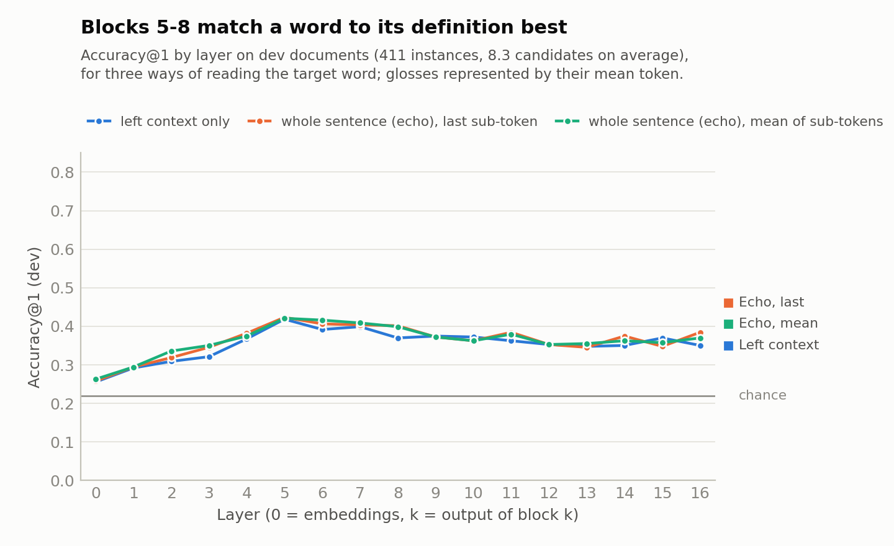
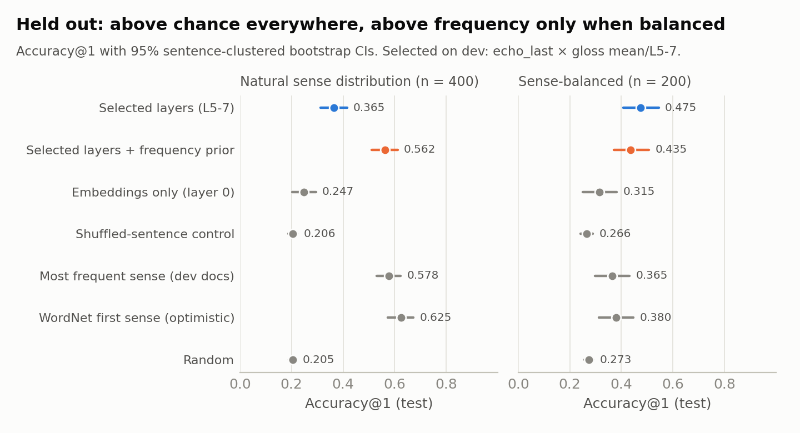
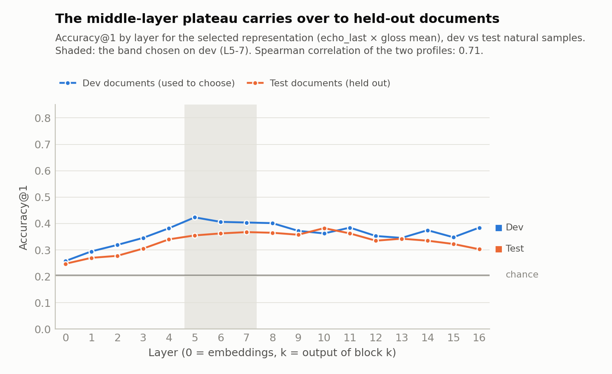

# Which layers of Llama-3.2-1B disambiguate word senses?

> This follows on from [`REPORT.md`](REPORT.md), written on 5 November 2026. It implements that report's §5.1 (fix,
> validate, re-run) and then runs a small layer study. Every choice is made on **dev documents**; the frozen
> result is then scored once on **held-out test documents**. All numbers come from
> [`Analysis/layer_study.py`](../Analysis/layer_study.py), and the raw output is in
> [`layer_study/results.json`](layer_study/results.json).

## Summary

**Which layers are best? The middle of the network.** Matching a word in context to its WordNet definition works
best with the states after **blocks 5–7** of Llama-3.2-1B's 16. In the March 2025 notebooks' numbering, these are
layers 4–6.
- **How it was chosen.** A search over 372 configurations on dev documents selected this band. Block 5 on its own
  does as well (+0.01 for the band, p = 0.53).
- **The rest of the profile.** The embeddings and the first blocks are weakest. Accuracy plateaus through the
  middle blocks and drifts down towards the last ones.
- **How it is measured.** Glosses represented by the mean of their tokens score about 0.07 higher than glosses
  represented by their last token. Whether the target word has seen the whole sentence (echo) or only its left
  context makes little difference (0.01–0.02).

**Validation on held-out documents (never used for any choice).** The frozen choice scores:

| Test sample | Selected layers (5–7) | Chance | Shuffled-sentence control | Most frequent sense (dev docs) |
|---|---:|---:|---:|---:|
| Natural sense distribution (400 instances) | **0.365** [0.313, 0.416] | 0.205 | 0.206 | 0.578 |
| Sense-balanced (200 instances) | **0.475** [0.408, 0.545] | 0.273 | 0.266 | 0.365 |

Accuracy@1 with 95% sentence-clustered bootstrap CIs.

- **The signal is real and comes from context.** The selected layers beat chance and the shuffled-sentence control by
  0.16–0.21 (p ≤ 0.001), and beat the context-free embeddings by 0.12–0.16.
- **The layer profile replicates.** The dev and test curves correlate at Spearman 0.71. On test, accuracy plateaus
  from block 5 to block 11. The band that hindsight would have chosen (blocks 7–10) scores 0.388, only 0.02 more
  than the frozen choice.
- **But sense frequency still wins on natural text.**
  - Always picking the most frequent sense scores 0.578, against 0.365.
  - Adding a frequency prior gives 0.562, no better than frequency alone on held-out documents (+0.010 over the
    prior, p = 0.67), although it helped on dev.
  - The layers only beat frequency when senses are balanced: +0.11, p = 0.04.

**What this means.** Once the March 2025 bugs are fixed, Llama-3.2-1B's middle layers clearly encode which sense a
word is used in. On balanced data the old pipeline was at chance; the fixed one finds a significant, replicable
effect. But unsupervised gloss matching with a 1B model is not yet a competitive WSD system on natural text. The
next step that is most likely to change that is supervised: sense centroids from labelled dev-document examples
([§3.7](#37-limitations-and-next-steps)).

---

## 1. What was fixed

Every bug from [`REPORT.md` §4](REPORT.md#4-bugs-and-issues) that affects the new pipeline is fixed and covered by
a test. Run the tests with `.venv/bin/python -m tests.run_tests`; add `WSD_SLOW_TESTS=1` to include the parity test.

| Bug | Fix | Where | Guarded by |
|---|---|---|---|
| B1 wrong focus token | Targets are located by character offsets (tiktoken `decode_with_offsets`), and the *last* sub-token is read | [`Processing/prompts.py`](../Processing/prompts.py) | `test_prompts`: 18,422 targets in 1,500 random sentences, 0 mismatches (was 57% wrong) |
| B2 HF-permuted q/k | `load_params` un-permutes q/k, and your existing pickle is repaired as it loads | [`LLM/llama_jax/weights.py`](../LLM/llama_jax/weights.py) | `test_model_parity`, `test_model_unit` |
| B3 no causal mask | A causal mask plus a length-based padding mask | [`LLM/llama_jax/model.py`](../LLM/llama_jax/model.py) | `test_model_parity`: causality and padding-invariance tests |
| B4 validation blind spots | A parity test against HF `transformers` at every layer, at real positions | [`tests/test_model_parity.py`](../tests/test_model_parity.py) | centred cosine ≥ 0.9999 at all 17 layers (was 0.06 at layer 8); 74/75 next tokens agree |
| B5 RoPE scaling | `high_freq_factor = 4`, fixed in both the JAX and the PyTorch reference code | `model.py` (both) | `test_model_unit`: frequencies equal HF's `llama3` initialisation |
| B6 no BOS | Every sequence starts with `<\|begin_of_text\|>` | `prompts.py` | `test_prompts` |
| B7, B13 separators and crashes | The dataset is JSON lines (no joined strings, no NaN); no check can raise | [`Processing/semcor_data.py`](../Processing/semcor_data.py) | `test_data`, `test_prompts` (lemmas such as `jr.` and `null`) |
| B8 tie-breaking | Ties are broken uniformly at random | [`Processing/evaluation.py`](../Processing/evaluation.py) | `test_evaluation` |
| B9, B10 selection and notebook state | Selection uses dev only; bootstrap CIs and paired tests; a script instead of notebook state | `evaluation.py`, [`Analysis/layer_study.py`](../Analysis/layer_study.py) | `test_evaluation` |
| B12 `!` masked as padding | Pad id 128004; the mask comes from lengths | `model.py`, [`Processing/extract.py`](../Processing/extract.py) | `test_model_parity` |
| B14 candidates of every POS | Candidates are the synsets of the lemma *and* its POS (adjectives include satellites) | `semcor_data.py` | `test_data` |
| B15 `fix_whitespace` damage | A detokeniser that never changes a token's characters and records each token's span | `semcor_data.py` | `test_data` |
| B16 storage and robustness | One forward pass per sentence; float16 vector store (~70 KB per vector); no hard-coded widths; append-safe | `extract.py`, [`Processing/script.py`](../Processing/script.py) | `test_extract` |
| Numerics | RMSNorm ε = 1e-5; norms and softmax in float32 | `model.py` | `test_model_unit`, `test_model_parity` |

B11 (the "rolling delta" copy-paste) lives in the March 2025 notebooks. They are kept unchanged as a record, and the new
analysis does not use deltas.

---

## 2. Method

### 2.1 Data and splits

The v2 dataset ([`Processing/build_dataset.py`](../Processing/build_dataset.py)) re-parses SemCor: 352 documents,
37,176 sentences and 226,036 sense-tagged instances.
- **Candidates.** The WordNet synsets of the instance's lemma *and* part of speech, in WordNet order: 8.0 on average
  for polysemous words. The 16.9% of instances with only one candidate are excluded from all samples.
- **Split.** The documents are split 50/50 into **dev** (176) and **test** (176), stratified by Brown-corpus genre, so
  no document contributes to both choosing and checking.

Four samples were drawn with seed 0:

| Sample | Split | Kind | Instances | Sentences | Mean candidates |
|---|---|---|---:|---:|---:|
| `dev_natural_80` | dev | 80 random sentences, all their polysemous targets | 411 | 80 | 8.3 |
| `test_natural_80` | test | same | 400 | 80 | 8.6 |
| `dev_balanced_200` | dev | sense-balanced | 200 | 196 | 5.9 |
| `test_balanced_200` | test | sense-balanced | 200 | 198 | 4.6 |

The **natural** samples keep SemCor's real sense distribution, where the most frequent sense dominates. The
**balanced** samples take lemmas seen with at least two senses in the split and use one instance per sense (up to
four senses per lemma). Frequency then helps only on about one instance per lemma, so they test whether the model
reads the context. Candidates are always the full POS-restricted WordNet list, so balanced instances still have
unobserved rare senses as distractors.

### 2.2 Representations

**Sentence side.** One causal forward pass per sentence over `[BOS] text text` (the "echo" form, Springer et al.
2024). The target is located by character offsets, and three vectors are read for it:

| Name | What it is | Context it has seen |
|---|---|---|
| `plain_last` | Last sub-token of the word in the first copy | Left context only, identical to a plain pass (verified) |
| `echo_last` | Last sub-token of the word in the second copy | The whole sentence |
| `echo_mean` | Mean over the word's sub-tokens in the second copy | The whole sentence |

**Gloss side.** One pass per candidate over `[BOS] lemma: gloss`:

| Name | What it is |
|---|---|
| `mean` | Mean over the gloss tokens |
| `last` | The final token's state |

The target word is never read at position 0 of a definition prompt. Under causal attention that position cannot see
the definition, so every candidate would get the same vector (REPORT.md, B3 and B6).

**Layers.** Vectors are read at all 17 states: **0 = token embeddings, k = output of block k** (HuggingFace
convention). The March 2025 notebooks numbered blocks 0–15, so their "layer 2" is layer 3 here.

### 2.3 Scoring, search and selection

- **Score.** The cosine between the centred sentence vector and each centred gloss vector, with the centring means
  fitted on dev only. The prediction is the highest-scoring candidate.
- **Search on dev.** The search uses `dev_natural_80`: 3 sentence representations × 2 gloss representations × 62
  contiguous bands of 1–4 layers (a band's score is the mean of its layers' cosines), giving **372 configurations**,
  ranked by accuracy@1.
- **Freeze.** The winner is frozen, together with the best *single* layer for the winning representation.
- **Validate.** The frozen configurations are scored once on `test_natural_80` and `test_balanced_200`.

### 2.4 Baselines and statistics

| Baseline | What it tells you |
|---|---|
| Random | Chance level: the exact expectation, 1/n per instance |
| **MFS from dev documents** | The most frequent gold sense of the lemma in *dev* documents (WordNet order for unseen lemmas). This is the fair frequency baseline for test documents. |
| WordNet first sense | **Optimistic.** WordNet's sense order comes from SemCor tag counts, test documents included. |
| Shuffled-sentence control | The selected configuration, scored against *another* instance's sentence vector. It shows how much comes from gloss-side priors rather than the context. |
| Embeddings only (layer 0) | The same scoring on the raw token embeddings, which carry no context: lexical overlap only |

The 95% CIs come from a bootstrap that resamples **sentences**, because targets from one sentence are not
independent (2,000 replicates). Differences use a paired bootstrap on the same instances.

---

## 3. Results

### 3.1 Accuracy by layer on dev



Accuracy@1 on `dev_natural_80` (411 instances; chance 0.22). Columns are layers (0 = embeddings, k = block k), and
the best layer in each row is in bold.

| Representation (sentence × gloss) | L0 | L2 | L3 | L4 | L5 | L6 | L7 | L8 | L9 | L10 | L11 | L12 | L14 | L16 |
|---|---:|---:|---:|---:|---:|---:|---:|---:|---:|---:|---:|---:|---:|---:|
| Left context × mean gloss | 0.26 | 0.31 | 0.32 | 0.37 | **0.42** | 0.39 | 0.40 | 0.37 | 0.37 | 0.37 | 0.36 | 0.35 | 0.35 | 0.35 |
| **Echo, last × mean gloss** | 0.26 | 0.32 | 0.35 | 0.38 | **0.42** | 0.41 | 0.40 | 0.40 | 0.37 | 0.36 | 0.38 | 0.35 | 0.37 | 0.38 |
| Echo, mean × mean gloss | 0.26 | 0.34 | 0.35 | 0.37 | **0.42** | 0.42 | 0.41 | 0.40 | 0.37 | 0.36 | 0.38 | 0.35 | 0.36 | 0.37 |
| Echo, last × last-token gloss | 0.22 | 0.32 | 0.31 | **0.35** | 0.31 | 0.34 | 0.33 | 0.31 | 0.31 | 0.31 | 0.29 | 0.29 | 0.25 | 0.27 |

- **The shape is the same for every sentence representation.** Accuracy climbs from the embeddings (0.26) to a peak
  at block 5 (0.42), stays near it to block 8, then settles at 0.35–0.38.
- **Mean-pooled glosses are clearly better** than the gloss's last token, which peaks earlier (block 4, 0.35) and
  falls below 0.30 in the last blocks.
- **The three sentence representations are almost indistinguishable** at the peak. On these short SemCor sentences,
  seeing the right-hand context (echo) helps far less than it did in the pilot.

### 3.2 What the dev search chose

The search covered 6 representation pairs × 62 contiguous bands of 1–4 layers. Every one of the ten best
configurations uses mean-pooled glosses and layers within 5–8:

| Rank | Configuration | Dev accuracy@1 |
|---:|---|---:|
| 1 | **echo, last × mean gloss, blocks 5–7** (selected) | 0.428 [0.376, 0.477] |
| 2 | echo, mean × mean gloss, blocks 5–6 | 0.426 |
| 3 | echo, last × mean gloss, block 5 (best single layer, also frozen) | 0.423 [0.377, 0.462] |
| 4 | echo, last × mean gloss, blocks 5–8 | 0.423 |
| 5 | echo, mean × mean gloss, blocks 5–7 | 0.423 |
| 6 | echo, last × mean gloss, blocks 5–6 | 0.421 |
| 7 | echo, mean × mean gloss, block 5 | 0.421 |
| 8 | echo, mean × mean gloss, blocks 5–8 | 0.421 |
| 9 | left context × mean gloss, block 5 | 0.418 |
| 10 | echo, mean × mean gloss, blocks 6–7 | 0.418 |

The top ten span only 0.010, far less than the CIs, so the data pins down *the region* rather than a single
configuration. Run on the sense-balanced dev sample, the same search picks block 7, also inside the selected band.

### 3.3 Validation on held-out documents



The table compares each system with the selected configuration. Differences are selected minus baseline,
paired-bootstrapped over sentences.

| `test_natural_80` (400 instances, 80 sentences) | Accuracy@1 [95% CI] | MRR | Selected minus this |
|---|---:|---:|---|
| **Selected: echo, last × mean gloss, blocks 5–7** | **0.365** [0.313, 0.416] | 0.557 | — |
| Best single layer (block 5) | 0.355 [0.305, 0.405] | 0.552 | +0.010 [−0.017, +0.041], p = 0.53 |
| Embeddings only (layer 0) | 0.247 [0.203, 0.295] | 0.468 | +0.117 [+0.069, +0.168], p = 0.001 |
| Shuffled-sentence control | 0.206 [0.188, 0.223] | 0.429 | +0.159 [+0.110, +0.209], p = 0.001 |
| Random | 0.205 [0.191, 0.219] | 0.425 | +0.160 [+0.112, +0.209], p = 0.001 |
| Most frequent sense (dev documents) | 0.578 [0.531, 0.624] | 0.743 | −0.212 [−0.270, −0.153], p = 0.001 |
| WordNet first sense (optimistic) | 0.625 [0.573, 0.673] | 0.776 | −0.260 [−0.318, −0.201], p = 0.001 |

| `test_balanced_200` (200 instances) | Accuracy@1 [95% CI] | MRR | Selected minus this |
|---|---:|---:|---|
| **Selected: echo, last × mean gloss, blocks 5–7** | **0.475** [0.408, 0.545] | 0.684 | — |
| Best single layer (block 5) | 0.455 [0.388, 0.525] | 0.672 | +0.020 [−0.035, +0.079], p = 0.53 |
| Embeddings only (layer 0) | 0.315 [0.251, 0.382] | 0.562 | +0.160 [+0.076, +0.243], p = 0.003 |
| Shuffled-sentence control | 0.266 [0.242, 0.290] | 0.522 | +0.209 [+0.140, +0.281], p = 0.001 |
| Random | 0.273 [0.257, 0.291] | 0.526 | +0.202 [+0.131, +0.272], p = 0.001 |
| Most frequent sense (dev documents) | 0.365 [0.299, 0.432] | 0.620 | +0.110 [+0.010, +0.213], p = 0.037 |
| WordNet first sense (optimistic) | 0.380 [0.313, 0.447] | 0.636 | +0.095 [−0.005, +0.192], p = 0.058 |

- **The signal comes from the context.** Scoring the same glosses against another instance's sentence drops
  accuracy to chance. The gain over the embeddings shows that what matters is the model's contextual processing, not
  lexical overlap between the word and the definition.
- **Dev overestimates slightly.** The selected configuration scored 0.428 on dev and 0.365 on test natural. That is
  what choosing the best of 372 configurations, plus sampling noise, leads you to expect, and it is why a held-out
  split was needed.
- **The two frequency baselines answer different questions.** The fair one uses only dev-document labels. WordNet's
  first sense also benefits from test-document counts.

### 3.4 Does the layer profile transfer?



Accuracy@1 for the selected representation (echo, last × mean gloss) on all four samples:

| Sample | L0 | L2 | L3 | L4 | L5 | L6 | L7 | L8 | L9 | L10 | L11 | L12 | L14 | L16 |
|---|---:|---:|---:|---:|---:|---:|---:|---:|---:|---:|---:|---:|---:|---:|
| dev natural | 0.26 | 0.32 | 0.35 | 0.38 | 0.42 | 0.41 | 0.40 | 0.40 | 0.37 | 0.36 | 0.38 | 0.35 | 0.37 | 0.38 |
| test natural | 0.25 | 0.28 | 0.30 | 0.34 | 0.35 | 0.36 | 0.37 | 0.36 | 0.36 | 0.38 | 0.36 | 0.34 | 0.34 | 0.30 |
| dev balanced | 0.26 | 0.30 | 0.33 | 0.40 | 0.45 | 0.45 | 0.47 | 0.41 | 0.40 | 0.41 | 0.41 | 0.41 | 0.44 | 0.43 |
| test balanced | 0.32 | 0.36 | 0.36 | 0.43 | 0.46 | 0.50 | 0.45 | 0.43 | 0.45 | 0.45 | 0.42 | 0.41 | 0.39 | 0.34 |

- **The shape transfers.** All four samples show the same pattern: a steep rise up to blocks 4–5, a high plateau
  through the middle blocks, and a decline at the end. The two natural-sample curves correlate at Spearman 0.71.
- **The test plateau is wider and flatter** (blocks 5–11, 0.35–0.38). Its single best layer is block 10 (0.383),
  and the band hindsight would choose is blocks 7–10 (0.388). Choosing on dev cost about 0.02.
- **The last blocks are a poor choice on held-out data.** Block 16 drops to 0.30 on test natural and 0.34 on test
  balanced.

### 3.5 By part of speech (test)

| | Nouns | Verbs | Adjectives | Adverbs |
|---|---:|---:|---:|---:|
| Natural: selected layers | 0.47 (n = 154) | 0.30 (199) | 0.32 (28) | 0.32 (19) |
| Natural: WordNet first sense | 0.71 | 0.56 | 0.71 | 0.53 |
| Balanced: selected layers | 0.46 (98) | 0.48 (54) | 0.47 (34) | 0.57 (14) |
| Balanced: WordNet first sense | 0.38 | 0.39 | 0.41 | 0.29 |

- **Verbs are the hard case on natural text.** They make up half of the natural sample, and their sense inventories
  are large and fine-grained.
- **On balanced data the parts of speech are similar**, and every one beats the frequency baseline. The adjective and
  adverb counts are small.

### 3.6 Does the layer signal add anything on top of sense frequency?

This follow-up adds λ × log P(sense | lemma) to the frozen layer score. The prior is estimated from dev-document
labels, leaving out each dev instance's own document so that it never sees its own label. λ is tuned on dev only;
λ = 0.1 was best (dev accuracy 0.667, against 0.428 for the layers alone and 0.613 for the prior alone).

| Held-out sample | Layers alone | Prior alone | Layers + prior | Most frequent sense (dev docs) |
|---|---:|---:|---:|---:|
| Natural | 0.365 | 0.552 | **0.562** [0.512, 0.612] | 0.578 |
| Balanced | **0.475** | 0.335 | 0.435 [0.372, 0.508] | 0.365 |

- **On natural text, the combination does not beat frequency on held-out documents.** It is −0.015 against MFS
  (p = 0.55) and +0.010 against the prior alone (p = 0.67). The +0.054 it gained on dev did not transfer.
- **The layer signal here is real but weak.** It is too weak to beat a frequency prior that is right 58% of the time.
- **On balanced data the prior hurts a little,** as it should when frequency carries no information.

### 3.7 Limitations and next steps

**Limitations**
- **Small samples.** There are 411 and 400 natural instances, from only 80 sentences each, plus 200 balanced
  instances per split. CIs are about ±0.05 on natural data and ±0.07 on balanced data, so the study pins down the
  *region* of good layers (5–8), not one best layer.
- **Narrow setup.** One model and one prompt template per side, scored only by unsupervised gloss matching, on SemCor
  only.
- **Hard candidate lists.** Candidates are all of WordNet's senses for the lemma and POS, rare ones included: 8.6 on
  average on test natural. This is harder than the observed-senses-only lists of the old Uniform2 data and the
  November pilot.

**Next steps, in order of expected payoff**
1. **Supervised sense centroids.** Represent each sense by the mean target vector of its *dev-document* examples
   (layers 5–8), then classify test instances by nearest centroid, falling back to the gloss for unseen senses. This
   uses the same cached vectors; only more dev sentences are needed. It is the classic way to beat MFS, and it tests
   whether the middle-layer signal is *linearly* strong, not just above chance.
2. **Better gloss representations.** Add WordNet's example sentences, try other prompt templates, or use whitening in
   place of centring. Gloss representation was the biggest lever in this study.
3. **More data, and standard test sets.** Run larger samples and Raganato et al.'s SensEval/SemEval sets on a GPU. On
   this CPU, the four samples took 63 minutes; a GPU would take minutes.
4. **Larger models.** Test whether the middle-layer optimum holds, and whether gloss matching closes the gap to
   frequency, for Llama-3.2-3B and 3.1-8B.

---

## 4. Reproducing this study

From the repository root in WSL (the whole sequence is in [`Processing/run_script.bash`](../Processing/run_script.bash)):

```bash
PY=.venv/bin/python
$PY -m Processing.build_dataset                                   # v2 dataset (about 1 minute)
for s in "dev natural 80" "test natural 80" "dev balanced 200" "test balanced 200"; do
  set -- $s; $PY -m Processing.script sample --split $1 --kind $2 --n $3
done
$PY -m Processing.script extract --samples dev_natural_80 test_natural_80 dev_balanced_200 test_balanced_200
$PY Analysis/layer_study.py && $PY Analysis/layer_study_figures.py
```

Runtimes on the 4-core development laptop (float32 JAX):
- **Extraction:** 551 sentences and 4,361 definition prompts, or 87,076 tokens (121,464 including padding), in 62.5
  minutes. That is about 23 real tokens/s, or 32 padded.
- **Layer study:** about 2 minutes.
- **Figures:** a few seconds.
- **Tests:** about 4 minutes for the fast suite, plus about 6 minutes for the JAX-vs-HF parity test.

The vectors are cached in `Data/Processed/v2/activations/`, so a re-run only computes what is missing. Console logs are
in [`layer_study/`](layer_study/).
