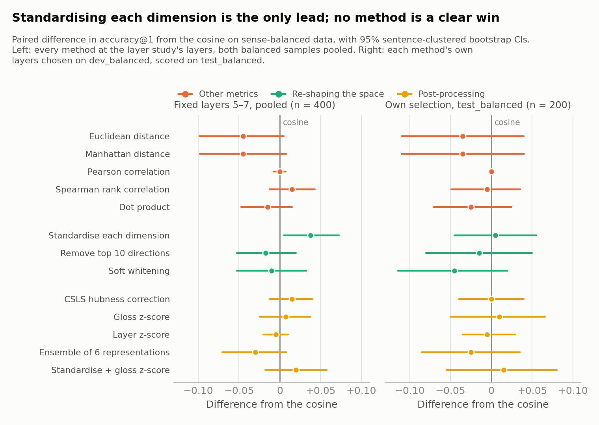
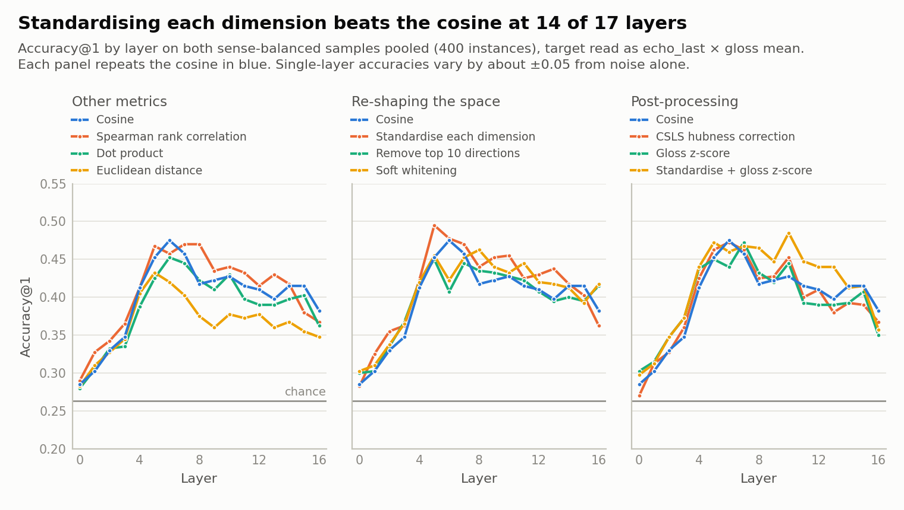

# Can a different similarity measure pick out word senses better than the cosine?

> This follows on from [`LAYER_STUDY.md`](LAYER_STUDY.md) and was written on 7 November 2026. It tests other
> similarity metrics, and cheap post-processing, on the layer study's vectors. Everything is judged **only on
> sense-balanced data**: the question is how well the method picks out word senses, not how well it exploits the
> natural sense distribution. Nothing uses sense labels or frequencies, and no new extraction was needed. All
> numbers come from [`Analysis/metrics_study.py`](../Analysis/metrics_study.py), with the raw output in
> [`metrics_study/results.json`](metrics_study/results.json). Every function is worked through, with examples, in
> [`Analysis/metrics_methods.ipynb`](../Analysis/metrics_methods.ipynb).

## Summary

**What was tested.** The layer study scores each candidate sense by the cosine between the centred target vector
and the centred gloss vector. Thirteen alternatives were tested, in three families:

- **Other metrics:** Euclidean and Manhattan distances, Pearson and Spearman correlations across the vectors'
  dimensions, and the dot product.
- **Re-shaping the space before the cosine:** standardising each dimension (dividing it by its spread), removing
  the top 10 principal directions, and soft whitening.
- **Post-processing the cosines:** two corrections for "hub" glosses that are close to everything (CSLS and a gloss
  z-score), z-scoring each layer before averaging a band, an ensemble of all six target × gloss representations,
  and standardisation combined with the gloss z-score.

Every statistic these methods need is fitted on unlabelled dev_natural vectors, so no balanced instance enters a
fit. The main comparison holds the layer study's layers and representation fixed. Nothing is tuned on balanced
data, so both balanced samples can be pooled: 400 instances.

**Result: one lead, no clear win.**

| Method | Balanced accuracy@1, pooled (400) | vs cosine [95% CI] |
|---|---:|---|
| **Cosine** (baseline) | **0.460** [0.411, 0.506] | |
| Standardise each dimension | 0.497 [0.450, 0.547] | +0.037 [+0.005, +0.072], p = 0.034 |
| Standardise + gloss z-score | 0.480 | +0.020 [−0.018, +0.058], p = 0.33 |
| CSLS hubness correction | 0.475 | +0.015 [−0.012, +0.040], p = 0.30 |
| Spearman rank correlation | 0.475 | +0.015 [−0.013, +0.043], p = 0.34 |
| The other nine | 0.415–0.468 | −0.045 to +0.007, p ≥ 0.09 |

Chance is 0.264.

- **Standardising each dimension is the one lead.** It improves both balanced samples separately (dev 0.445 to
  0.485, test 0.475 to 0.510). It beats the cosine at 14 of 17 single layers, and it raises mean reciprocal rank
  from 0.666 to 0.691.
- **But it is not established.** With 13 methods tested, its Holm-adjusted p is 0.44. When every method picks its
  own layers on dev_balanced, its edge on test_balanced shrinks to +0.005 (0.470 against 0.465).
- **Nothing else comes close.** The hubness corrections and the rank correlation trend slightly positive. The
  distances, the dot product, removing directions, whitening and the ensemble trend negative. No other difference
  is significant, even before correction.

**Why so little moves.**
- **Centring already does most of the work.** After the layer study's centring, a gloss's average cosine with
  unrelated targets varies by only about ±0.01, so the hubness corrections have little to remove. The Pearson
  correlation is the cosine in practice: it changes 2 of 400 picks.
- **The distances and the dot product let vector length back in.** The gloss-mean study showed that a gloss
  vector's length mostly tracks how long the definition is, which says nothing about the sense.
- **Standardisation targets a real but mild imbalance.** The largest single dimension carries about 1% of the
  variance, 20 times an even share. Dividing each dimension by its spread stops the high-variance dimensions from
  dominating the cosine. Removing or shrinking whole principal directions throws away more than it fixes.

**What this means.** The centred cosine is hard to beat with cheap tricks. Standardisation is the one change worth
carrying forward, and it needs confirming on a larger sense-balanced sample first.

---

## 1. What was built

| File | What it does |
|---|---|
| [`Processing/similarity.py`](../Processing/similarity.py) | The metrics, the re-shaped spaces and the post-processing. |
| [`Analysis/metrics_study.py`](../Analysis/metrics_study.py) | The experiment (protocol in [§2.2](#22-protocol)). It took 26 minutes while sharing the CPU with an extraction. |
| [`Analysis/metrics_study_figures.py`](../Analysis/metrics_study_figures.py) | The two figures below. |
| [`Analysis/metrics_methods.ipynb`](../Analysis/metrics_methods.ipynb) | Every function documented, with hand-checkable examples and diagnostics on the real vectors. It is generated by [`build_metrics_notebook.py`](../Analysis/build_metrics_notebook.py). |
| [`tests/test_similarity.py`](../tests/test_similarity.py) | 6 unit tests covering the notebook's checks. |

## 2. Method

### 2.1 The methods

Per layer, $h$ is the centred target vector and $g_k$ is candidate $k$'s centred gloss vector, both centred with
the layer study's dev means. The highest score wins. A band of layers averages the per-layer scores, and every
score is scaled so that layers are comparable.

| Method | Score for candidate $k$ | Note |
|---|---|---|
| cosine | $\cos(h, g_k)$ | the layer study's score |
| Euclidean / Manhattan distance | $-\lVert h - g_k\rVert$, divided by the candidates' average distance (L2 or L1) | penalises gloss vectors that are long or short |
| Pearson correlation | the correlation between the 2,048 entries of $h$ and of $g_k$ | the cosine after removing each vector's own mean |
| Spearman rank correlation | the same, on the entries' ranks | ignores how large the large dimensions are |
| dot product | $\langle \hat h, g_k\rangle$, divided by the candidates' mean gloss length | rewards long gloss vectors |
| standardise | the cosine after dividing every dimension by its standard deviation | a diagonal whitening |
| remove top 10 directions | the cosine after removing the projection on the top 10 principal directions | "all-but-the-top" |
| soft whitening | the cosine after scaling principal direction $i$ by $\sqrt{\bar e / (e_i + \bar e)}$ | shrinks dominant directions; top 128 |
| CSLS | $2\cos(h, g_k) - r(g_k)$, with $r(g)$ the mean cosine of $g$ with its 10 nearest reference targets | a hubness correction |
| gloss z-score | $(\cos(h, g_k) - \mu(g_k)) / \sigma(g_k)$ over the reference targets | judges a gloss against its usual similarity |
| layer z-score | z-score the candidates at each layer, then average the band | every layer counts equally |
| ensemble | layer z-scores averaged over all six target × gloss representations | |
| standardise + gloss z-score | the gloss z-score in the standardised space | |

The fitted statistics (standard deviations, principal directions and the reference targets) come from dev_natural
without labels: its 411 target vectors for the sentence side, and the 1,999 gloss vectors of its candidates for the
gloss side.

### 2.2 Protocol

Fixed in the docstring of [`metrics_study.py`](../Analysis/metrics_study.py) before any result existed.

1. **Primary.** Every method at one fixed configuration: the layer study's frozen winner, *echo_last* × mean
   gloss, layers 5–7. The ensemble uses all six representations at layers 5–7. Nothing is tuned on balanced data,
   so dev_balanced and test_balanced are pooled (400 instances, 394 sentences). Each method is compared with the
   cosine by a paired, sentence-clustered bootstrap, and the 13 p-values are also Holm-adjusted.
2. **Secondary: each method's own layers.** Each method's search on dev_balanced (6 representations × 62 bands =
   372 configurations; 62 bands for the ensemble), frozen and scored on test_balanced. Each is paired against the
   cosine's own dev_balanced winner.
3. **Sensitivity**, at the fixed configuration: remove the top 1, 3 or 30 directions; CSLS with 5 or 50
   neighbours; the gloss z-score without the division by $\sigma$.
4. **Diagnostics:** accuracy by layer for every method, pooled.

The fixed configuration was chosen by the layer study on dev_natural, by natural-text accuracy. It is a choice of
layers and representation, not of senses, and using it means no tuning touches the balanced data.

## 3. Results

### 3.1 Fixed configuration, both balanced samples pooled



| Method | Pooled acc@1 [95% CI] | vs cosine [95% CI] | p | Holm p | dev / test | Picks changed |
|---|---|---|---:|---:|---|---:|
| **Cosine** (baseline) | **0.460** [0.411, 0.506] | | | | 0.445 / 0.475 | |
| *Other metrics* | | | | | | |
| Euclidean distance | 0.415 [0.367, 0.463] | −0.045 [−0.098, +0.005] | 0.086 | 1.00 | 0.400 / 0.430 | 39% |
| Manhattan distance | 0.415 [0.366, 0.465] | −0.045 [−0.098, +0.008] | 0.103 | 1.00 | 0.415 / 0.415 | 41% |
| Pearson correlation | 0.460 [0.411, 0.507] | +0.000 [−0.007, +0.007] | 1.000 | 1.00 | 0.450 / 0.470 | 0.5% |
| Spearman rank correlation | 0.475 [0.426, 0.526] | +0.015 [−0.013, +0.043] | 0.341 | 1.00 | 0.465 / 0.485 | 14% |
| Dot product | 0.445 [0.397, 0.492] | −0.015 [−0.048, +0.015] | 0.400 | 1.00 | 0.450 / 0.440 | 17% |
| *Re-shaping the space* | | | | | | |
| **Standardise each dimension** | **0.497** [0.450, 0.547] | **+0.037** [+0.005, +0.072] | 0.034 | 0.44 | 0.485 / 0.510 | 18% |
| Remove top 10 directions | 0.443 [0.394, 0.490] | −0.018 [−0.053, +0.020] | 0.391 | 1.00 | 0.420 / 0.465 | 23% |
| Soft whitening | 0.450 [0.403, 0.500] | −0.010 [−0.052, +0.032] | 0.718 | 1.00 | 0.440 / 0.460 | 26% |
| *Post-processing* | | | | | | |
| CSLS hubness correction | 0.475 [0.424, 0.523] | +0.015 [−0.012, +0.040] | 0.300 | 1.00 | 0.450 / 0.500 | 9% |
| Gloss z-score | 0.468 [0.418, 0.516] | +0.007 [−0.025, +0.038] | 0.688 | 1.00 | 0.450 / 0.485 | 16% |
| Layer z-score | 0.455 [0.409, 0.502] | −0.005 [−0.020, +0.010] | 0.621 | 1.00 | 0.440 / 0.470 | 3% |
| Ensemble of 6 representations | 0.430 [0.381, 0.479] | −0.030 [−0.070, +0.008] | 0.159 | 1.00 | 0.390 / 0.470 | 26% |
| Standardise + gloss z-score | 0.480 [0.433, 0.529] | +0.020 [−0.018, +0.058] | 0.328 | 1.00 | 0.455 / 0.505 | 21% |
| Random | 0.264 [0.251, 0.277] | | | | | |

Paired differences are cluster-bootstrap estimates (2,000 resamples of sentences). "Picks changed" is the share
of the 400 targets where the method's top sense differs from the cosine's. Mean reciprocal rank orders the methods
the same way: 0.666 for the cosine, 0.691 for standardisation, 0.679 for standardisation + gloss z-score, 0.678 for
Spearman and 0.672 for CSLS, with every other method at or below 0.667.

- **Standardisation is the only method whose CI excludes zero,** and its gain appears in both halves: +0.040 on
  dev_balanced and +0.035 on test_balanced. It changes 18% of picks and gains 15 more than it loses. One such
  result among 13 is roughly what chance alone would produce, though, and the Holm adjustment puts its p at 0.44.
- **The hubness corrections help a little at best.** CSLS +0.015, the gloss z-score +0.007.
- **The distances and the dot product hurt.** The two distances change the most picks (39–41%) and lose 0.045;
  the dot product loses 0.015. All three let the length of the gloss vector into the score.

### 3.2 Each method's own layers

| Method | Selected on dev_balanced | Dev acc@1 | Test acc@1 [95% CI] | vs cosine [95% CI] | p |
|---|---|---:|---|---|---:|
| **Cosine** (baseline) | echo_mean × mean gloss, layers 6–8 | 0.480 | **0.465** [0.395, 0.540] | | |
| Euclidean distance | echo_last × mean gloss, layer 5 | 0.435 | 0.430 [0.363, 0.500] | −0.035 [−0.109, +0.040] | 0.399 |
| Manhattan distance | echo_last × mean gloss, layer 5 | 0.440 | 0.430 [0.362, 0.500] | −0.035 [−0.110, +0.040] | 0.401 |
| Pearson correlation | echo_mean × mean gloss, layers 6–8 | 0.480 | 0.465 [0.395, 0.540] | +0.000 [+0.000, +0.000] | 1.000 |
| Spearman rank correlation | echo_mean × mean gloss, layers 5–8 | 0.485 | 0.460 [0.392, 0.532] | −0.005 [−0.049, +0.035] | 0.895 |
| Dot product | echo_last × mean gloss, layers 4–7 | 0.455 | 0.440 [0.374, 0.510] | −0.025 [−0.070, +0.025] | 0.394 |
| Standardise each dimension | echo_mean × mean gloss, layers 6–7 | 0.490 | 0.470 [0.405, 0.543] | +0.005 [−0.045, +0.055] | 0.950 |
| Remove top 10 directions | echo_last × mean gloss, layer 5 | 0.450 | 0.450 [0.382, 0.518] | −0.015 [−0.080, +0.050] | 0.724 |
| Soft whitening | echo_last × mean gloss, layer 11 | 0.470 | 0.420 [0.352, 0.488] | −0.045 [−0.114, +0.020] | 0.198 |
| CSLS hubness correction | echo_mean × mean gloss, layer 7 | 0.485 | 0.465 [0.400, 0.535] | +0.000 [−0.040, +0.040] | 1.000 |
| Gloss z-score | echo_mean × mean gloss, layer 7 | 0.475 | 0.475 [0.408, 0.545] | +0.010 [−0.050, +0.066] | 0.782 |
| Layer z-score | echo_mean × mean gloss, layer 7 | 0.470 | 0.460 [0.392, 0.532] | −0.005 [−0.035, +0.030] | 0.931 |
| Ensemble of 6 representations | all six representations, layer 8 | 0.425 | 0.440 [0.373, 0.512] | −0.025 [−0.085, +0.035] | 0.491 |
| Standardise + gloss z-score | echo_last × mean gloss, layer 10 | 0.490 | 0.480 [0.409, 0.550] | +0.015 [−0.055, +0.080] | 0.729 |

- **No method beats the cosine here.** The best are standardisation + gloss z-score (+0.015) and the gloss z-score
  (+0.010), with CIs of about ±0.07.
- **Choosing layers on 200 instances is noisy.** The cosine's own choice (*echo_mean*, layers 6–8) scores 0.465 on
  test, below the fixed configuration's 0.475. Standardisation's choice (*echo_mean*, layers 6–7) scores 0.470,
  against 0.510 at the fixed configuration. Dev accuracies differ by 0.01–0.02 between neighbouring
  configurations, so the selected winner is close to arbitrary.

### 3.3 Sensitivity

| Variant | Pooled acc@1 | vs cosine [95% CI] | p |
|---|---:|---|---:|
| Remove the top 1 direction | 0.465 | +0.005 [−0.025, +0.037] | 0.820 |
| Remove the top 3 | 0.455 | −0.005 [−0.040, +0.030] | 0.846 |
| Remove the top 10 (primary) | 0.443 | −0.018 [−0.053, +0.020] | 0.391 |
| Remove the top 30 | 0.440 | −0.020 [−0.058, +0.020] | 0.350 |
| CSLS, 5 neighbours | 0.480 | +0.020 [−0.007, +0.045] | 0.176 |
| CSLS, 10 neighbours (primary) | 0.475 | +0.015 [−0.012, +0.040] | 0.300 |
| CSLS, 50 neighbours | 0.460 | +0.000 [−0.020, +0.020] | 1.000 |
| Gloss mean only, $\cos - \mu(g)$ | 0.460 | +0.000 [−0.015, +0.013] | 1.000 |
| Gloss z-score (primary) | 0.468 | +0.007 [−0.025, +0.038] | 0.688 |

- **Removing directions gets worse the more are removed.** Removing one direction is neutral; the principal
  directions carry sense information as well as shared variation.
- **CSLS fades as its neighbourhood grows,** from +0.020 with 5 neighbours to 0.000 with 50.
- **Subtracting each gloss's mean similarity does nothing** (+0.000). Its mean over the reference targets is almost
  the same for every gloss, so whatever the gloss z-score does comes from dividing by $\sigma(g)$.

### 3.4 Layer by layer



Accuracy@1 at single layers, pooled (400 instances), *echo_last* × mean gloss:

| Method | L0 | L2 | L4 | L5 | L6 | L7 | L8 | L10 | L12 | L14 | L16 |
|---|---:|---:|---:|---:|---:|---:|---:|---:|---:|---:|---:|
| Cosine (baseline) | 0.28 | 0.33 | 0.41 | 0.45 | 0.47 | 0.46 | 0.42 | 0.43 | 0.41 | 0.41 | 0.38 |
| Standardise each dimension | 0.28 | 0.35 | 0.42 | 0.49 | 0.48 | 0.47 | 0.44 | 0.46 | 0.43 | 0.42 | 0.36 |
| Spearman rank correlation | 0.29 | 0.34 | 0.41 | 0.47 | 0.46 | 0.47 | 0.47 | 0.44 | 0.41 | 0.42 | 0.37 |
| CSLS hubness correction | 0.27 | 0.33 | 0.42 | 0.46 | 0.47 | 0.46 | 0.42 | 0.45 | 0.41 | 0.39 | 0.37 |
| Gloss z-score | 0.30 | 0.35 | 0.44 | 0.45 | 0.44 | 0.47 | 0.43 | 0.45 | 0.39 | 0.39 | 0.35 |
| Standardise + gloss z-score | 0.30 | 0.35 | 0.44 | 0.47 | 0.46 | 0.47 | 0.47 | 0.48 | 0.44 | 0.41 | 0.36 |
| Soft whitening | 0.30 | 0.34 | 0.42 | 0.46 | 0.42 | 0.45 | 0.46 | 0.43 | 0.42 | 0.41 | 0.42 |
| Remove top 10 directions | 0.30 | 0.34 | 0.42 | 0.45 | 0.41 | 0.45 | 0.43 | 0.43 | 0.41 | 0.40 | 0.41 |
| Euclidean distance | 0.28 | 0.33 | 0.41 | 0.43 | 0.42 | 0.40 | 0.38 | 0.38 | 0.38 | 0.37 | 0.35 |

- **Standardisation is above the cosine at every layer from 1 to 14,** by up to 0.04 (layers 5 and 13). It is
  slightly below at layer 0 and the last two layers. That consistency is the best evidence that its gain is real.
  Neighbouring layers are not independent tests, though: they share the same targets.
- **Spearman's profile stays close to the cosine's,** with its largest gain at layer 8 (0.47 against 0.42).
- **The Euclidean distance falls further behind after layer 5,** ending 0.03 below the cosine at layer 16.

### 3.5 Diagnostics: what the corrections have to work with

From [`metrics_methods.ipynb`](../Analysis/metrics_methods.ipynb) §4, on the dev_natural reference vectors:

- **Variance is uneven but not extreme.** At layer 6 the largest single dimension carries about 1% of the target
  vectors' variance, 20 times an even share. The top 10 principal directions carry about a quarter (25% for
  targets, 29% for glosses), against 0.5% if variance were spread evenly. Standardisation evens out the dimensions;
  removing the top directions deletes a quarter of the variance, including some that separates senses.
- **There are hardly any hubs left.** At layer 6, a gloss's mean cosine with the 411 reference targets lies within
  ±0.01 of zero for every gloss, because the targets are centred. Corrections that subtract it change almost
  nothing. Wordier glosses are slightly bigger hubs (Spearman +0.37 between word count and mean cosine), which
  fits the gloss-mean study's finding.

### 3.6 Limitations and next steps

**Limitations.**
- **Sample size.** There are 400 pooled balanced instances, with CIs of about ±0.05 on accuracy and ±0.03–0.05 on
  paired differences. A +0.03 effect is at the edge of what this can detect, which is exactly where standardisation
  sits.
- **Multiplicity.** Thirteen methods were tested. The figure and tables show all of them, but the one positive
  result should be read as a lead to confirm, not a finding.
- **Fixed hyperparameters.** The number of directions removed, CSLS's neighbourhood and the whitening rank were set
  in advance, with sensitivity checks for two of them. Other values might do better, but tuning them on 200
  balanced dev instances would mostly fit noise.

**Next steps.**
1. **Confirm standardisation on a larger sense-balanced sample.** Extracting about 1,000 more balanced instances
   would take roughly an hour on this CPU. It would cut the CIs by about half, enough to settle a +0.03 effect.
2. **If it holds, use standardised vectors everywhere,** including in supervised sense centroids and any further
   contrast experiments.
3. **Supervised sense centroids** remain the most promising step
   ([`LAYER_STUDY.md` §3.7](LAYER_STUDY.md#37-limitations-and-next-steps)). They need no sense frequencies if each
   sense gets its own centroid, so they fit the balanced-only goal.

## 4. Reproducing

```bash
# from the repository root, in WSL; uses the layer study's cached vectors
.venv/bin/python -u Analysis/metrics_study.py            # about 25 minutes; writes Report/metrics_study/results.json
.venv/bin/python Analysis/metrics_study_figures.py       # the two figures, into Report/figures/
.venv/bin/python Analysis/build_metrics_notebook.py && \
    (cd Analysis && ../.venv/bin/jupyter nbconvert --to notebook --execute --inplace metrics_methods.ipynb)
.venv/bin/python -m tests.run_tests similarity           # the 6 new tests
```
