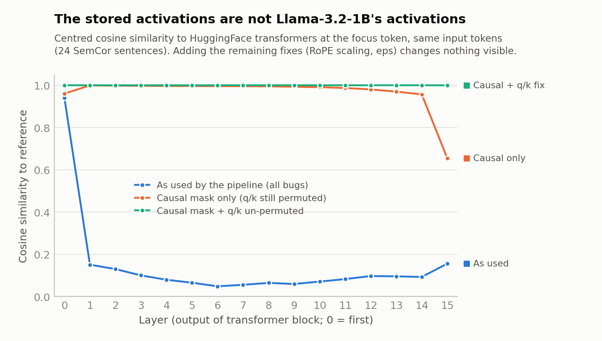
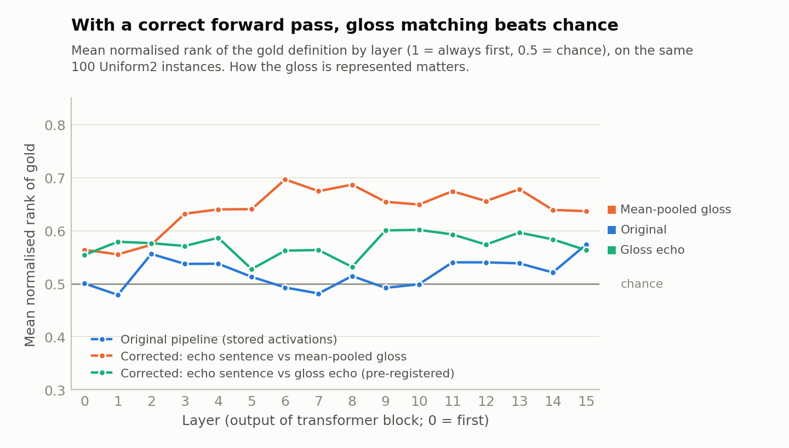

# Word-sense disambiguation from Llama-3.2-1B activations: project review

> Review of this repository's work from February–March 2025, written on 4 November 2026 on branch `Claude`.
> Every number below was recomputed from the project's own code, data, virtualenv and checkpoints. The scripts are in
> [`verification/`](verification/) and their raw outputs are in [`verification/results/`](verification/results/).

**Contents**

1. [Summary](#1-summary)
2. [Technical report: what the project built](#2-technical-report-what-the-project-built)
3. [Findings](#3-findings)
4. [Bugs and issues](#4-bugs-and-issues)
5. [Next directions](#5-next-directions)
6. [Appendix](#6-appendix)

---

## 1. Summary

**The idea.** Llama-3.2-1B reads a SemCor sentence containing an ambiguous word, and the hidden state of that word is
recorded at each of its 16 layers. The same is done for one short prompt per candidate WordNet sense, such as
`" bank: sloping land (especially the slope beside a body of water)"`. If the model's internal state encodes which
sense is meant, the sentence vector should be most similar to the gold sense's vector.

**What the notebooks concluded.** On the first 100 SemCor instances, the best combination of layers ranked the gold
definition at a mean normalised rank of 0.68 (median 0.80), where 0.5 is chance and 1 means the gold always comes
first. After resampling so that every sense of a word is equally frequent, this fell to 0.51–0.57. The last notebook
concluded that "distributions are largely responsible for the earlier results".

**What this review found.**

1. **The conclusion holds for the activations that were stored.** The balanced chunks show no detectable
   sentence-specific sense signal once confidence intervals, sentence-free baselines and a permutation null for the 256
   searched layer pairs are added. The layer pair chosen on the first chunk, (2, 12), scores 0.52 (95% CI 0.48–0.56)
   pooled over the 297 balanced instances. On the first chunk, simply ranking definitions in WordNet order scores
   **0.80**, more than any activation-based score, because WordNet lists senses by their SemCor frequency.
2. **The stored activations are not Llama-3.2-1B's activations, so the experiment never tested the idea.** The first
   three defects below each corrupt them on their own. The fourth makes the inputs unlike anything the model saw in
   training.
   - **Wrong token.** For 57% of SemCor instances (59–61% of the balanced chunks analysed), the "focus word" vector
     was read from a different token, typically about three tokens earlier: often a comma, an article or a fragment of
     an earlier word. `prep_row` treats the SemCor word index as an LLM token index.
   - **No causal mask.** The JAX model lets each token attend to the tokens after it. The stored vectors' centred
     cosine similarity to what the real model computes for the same tokens is 0.13 at layer 2 and 0.06 at layer 8.
   - **Scrambled rotary position encoding.** The weights come from the HuggingFace checkpoint, whose query and key
     matrices are permuted for HF's "rotate-half" RoPE, but the JAX code applies Meta's interleaved RoPE.
   - **No `<|begin_of_text|>` token.** In every definition prompt, the word being read out is the first token. In the
     real causal model that position becomes the attention sink, with a hidden-state norm 150–250× that of the other
     tokens. Fixing the causal mask without adding BOS would make this worse, not better.

   Validation missed all of these. The PyTorch reference used to check the JAX port shares the RoPE defects, and the
   end-to-end check compared logits at a padding position. The mismatch it did show was put down to bfloat16
   precision. Read at the right position, even the buggy model completes "The capital of France is" with " Paris".
3. **With a correct forward pass, a sense signal appears.** The pilot used the same 100 balanced instances on which
   the stored activations score at chance, with HF `transformers`, BOS, causal attention and the right token, plus a
   design suited to a causal model.
   - **Result.** The best design ranks the gold definition at **0.69 [0.61, 0.76]**, with **53% accuracy@1** (chance
     is 36%), at a middle layer fixed in advance. It stays at 0.63–0.70 from layer 3 to the last layer.
   - **The design matters.** The variant I had pre-registered as the headline, which represents each gloss by
     re-reading the word after it, did *not* beat chance. Mean-pooled gloss vectors did.
   - **Caveat.** This is a 100-instance pilot, not a result. Even so, it suggests the project's negative conclusion is
     an artefact of the bugs, and that the idea deserves a proper re-run.
4. **Recommended next step.** Re-run on a validated reference implementation (HF `transformers`, nnsight or
   TransformerLens) with the fixes in [§5.1](#51-fix-validate-re-run). Restrict candidates to the word's part of
   speech, keep the sense-balanced evaluation, compare against most-frequent-sense and shuffled-sentence baselines, and
   choose layers on held-out data. Then pick from the research directions in [§5.3](#53-research-directions).

---

## 2. Technical report: what the project built

### 2.1 Repository map

| Path | Contents |
|---|---|
| [`Data/SemCore.ipynb`](../Data/SemCore.ipynb) | Parses SemCor (Raganato et al. 2017 XML plus gold keys) into one row per sense-tagged instance. Adds the gold WordNet gloss (`definition`) and the glosses of all candidate synsets (`definitions`) via NLTK. |
| [`Data/SemCoreUniform.ipynb`](../Data/SemCoreUniform.ipynb), [`SemCoreUniform2.ipynb`](../Data/SemCoreUniform2.ipynb) | Sense-balanced variants of the dataset ([§2.3](#23-data)). |
| [`Data/Chunker.ipynb`](../Data/Chunker.ipynb) | Splits a dataset CSV into 100-row chunks. |
| [`LLM/llama/`](../LLM/llama/) | Meta's reference Llama 3 code, trimmed to run on a single CPU (model, tokenizer, generation). |
| [`LLM/llama_jax/model.py`](../LLM/llama_jax/model.py) | Functional JAX port of Llama (RMSNorm, RoPE, grouped-query attention, SwiGLU) in bfloat16. `reporting_transformer` returns the residual stream after every block. |
| [`LLM/llama.ipynb`](../LLM/llama.ipynb), [`llama_from_source.ipynb`](../LLM/llama_from_source.ipynb), [`llama_to_jax.ipynb`](../LLM/llama_to_jax.ipynb) | Running the model through HF `transformers` and from source, then validating the JAX port component by component. |
| [`LLM/convert_llama_to_hf.py`](../LLM/convert_llama_to_hf.py) | HF's Meta-to-HF checkpoint converter, used to create the `Llama3.2-1B-hf` checkpoint. |
| [`Processing/001…003*.ipynb`](../Processing/) | Development of weight pickling, prompt construction, batching and activation storage. |
| [`Processing/script.py`](../Processing/script.py), [`run_script.bash`](../Processing/run_script.bash) | Production job: one chunk CSV in; zipped activation pickles plus an index CSV out. |
| [`Analysis/*.ipynb`](../Analysis/) | Scoring and plots, one notebook per analysed chunk. |

Large files are git-ignored:
- `Data/Raw` (SemCor, 46 MB)
- `Data/Processed` (CSVs plus 940 MB of zipped activations)
- `Data/ModelWeights/llama_jax_weights.pkl` (2.8 GB)
- `Analysis/jax_store_tmp` (870 MB of unzipped activations from several chunks)

### 2.2 Pipeline

```text
SemCor XML + gold keys ─► Data/SemCore*.ipynb ─► SemCoreProcessed*.csv   (one row per tagged instance)
                                                       │  Data/Chunker.ipynb (100 rows per chunk)
                                                       ▼
HF safetensors ─► 001pickle_jax_weights ─► .pkl ─► Processing/script.py ◄─ SemCoreChunks*/chunk_N.csv
                                                       │  JAX reporting_transformer, bfloat16, CPU
                                                       ▼
                     ProcessedSemCoreChunks*/chunk_N.csv (index)  +  jax_store/*chunk_N.zip (activations)
                                                       │  Analysis/*.ipynb
                                                       ▼
                             per-layer similarity ranks ─► normalised rank of the gold sense
```

### 2.3 Data

The source is SemCor 3.0 in Raganato et al.'s (2017) unified format: 352 documents, 37,176 sentences and 226,036
sense-tagged instances. Each row stores:
- `word`: the surface form.
- `sentence`: the SemCor tokens joined with `|`.
- `word_loc`: the index of the word in that token list.
- `wordnet`: the gold sense key or keys.
- `definition`: the gloss of the first gold key.
- `definitions`: the glosses of **all** WordNet synsets of the lemma, across every part of speech, in WordNet order.

| Variant | Construction | Instances | Chunks | Mean candidates | Gold listed first | List-order baseline* |
|---|---|---:|---:|---:|---:|---:|
| Original | Every instance | 226,036 | 2,261 | 9.3 | 49% | 0.77 |
| Uniform | Per surface word with ≥2 observed senses, sample each sense `min_count` times. Candidates as Original. | 38,961 | 390 | 8.5–9.0 | 21–31% | 0.62–0.63 |
| Uniform2 | As Uniform, but candidates are the word's observed senses only, sorted alphabetically | 38,961 | 390 | 4.3 | 34% | 0.47 |

\* The mean normalised rank obtained by ranking candidates in their listed order, with no model involved (from
[`01_data_and_alignment.py`](verification/01_data_and_alignment.py)). Original is measured on a 20,000-instance random
sample; Uniform and Uniform2 on the chunks that were analysed. WordNet numbers senses by their SemCor tag counts, so on
SemCor "listed first" means "most frequent in this very corpus". That is why list order is such a strong baseline here.

### 2.4 Model

Llama-3.2-1B (base) has:
- 16 layers and model width 2,048
- 32 query heads and 8 key/value heads, each of size 64
- a SwiGLU MLP of width 8,192
- a 128,256-token vocabulary with tied embeddings
- RMSNorm with ε = 1e-5
- rotary position embeddings (RoPE, Su et al. 2024) with θ = 500,000 and "llama3" frequency scaling (factor 32,
  low/high frequency factors 1 and 4, original context 8,192)

[`LLM/llama_jax/model.py`](../LLM/llama_jax/model.py) implements this as pure functions over a parameter pytree, in
bfloat16. [`reporting_transformer`](../LLM/llama_jax/model.py#L258) returns a `(batch, 16, seq, 2048)` stack of
residual-stream states, taken after each block and before the final norm.
[`LLM/llama_to_jax.ipynb`](../LLM/llama_to_jax.ipynb) validated the port against Meta's reference code
(`LLM/llama/model.py`), first component by component (RMSNorm, RoPE frequencies and rotation, attention, MLP, block),
then end to end on one prompt. [`Processing/001pickle_jax_weights.ipynb`](../Processing/001pickle_jax_weights.ipynb)
converts the HF safetensors into a pickled pytree.

### 2.5 Prompts and activation extraction

[`Processing/script.py`](../Processing/script.py) processes one chunk:

1. **Sentence.** `' ' + fix_whitespace(' '.join(words))`: a leading space so the first word gets its usual
   space-prefixed token, and spaces before punctuation removed. Tokenised without BOS.
2. **Focus token.** `prep_row` computes `word_tok_index` (see [B1](#b1)).
3. **Definitions.** One prompt `f" {word}: {gloss}"` per candidate, with the focus at token 0 and no BOS.
4. **Clipping.** Sentences are clipped to 32 tokens centred on the focus token; definitions are truncated to 32
   tokens.
5. **Batching.** One record per sentence and per definition prompt, deduplicated by a SHA-256 of the tokens plus the
   focus index. Records are right-padded to 32 with token id 0, with a −∞ key mask wherever `token == 0`, and run in
   batches of 64 through a JIT-compiled `reporting_transformer`.
6. **Storage.** A 9-token window (focus ± 4) for all 16 layers, in bfloat16: a `(16, 9, 2048)` array of about 590 KB
   per record. Each array is pickled under a UUID, indexed by the output CSV, and the store is zipped (160–280 MB per
   100 instances).
7. **Cost.** About 64 s per batch of 64 prompts on the 4-core CPU (notebook 003), or roughly 15 minutes per chunk.
   The full corpus (2,261 chunks) would have needed about three weeks of CPU time and 0.6 TB of storage, which is what
   the minikube plan in [`Processing/Readme.md`](../Processing/Readme.md) was for.

### 2.6 Scoring

For each instance, the notebooks take window position 4 (the focus token) from the sentence record and from each
definition record, at every layer, and score each candidate in one of three ways:

- **Raw.** The dot product with the sentence vector. The chunk001 and Uniform2 notebooks un-comment an L2
  normalisation, which turns this into cosine similarity ([B10](#b10)).
- **Centred |·|.** Subtract the mean over {sentence, definitions} first, then take the absolute dot product.
- **Deltas.** Layer-to-layer differences, or differences from layer 0.

The candidates are then ranked, and the gold gets the normalised rank 1 − rank/(n − 1): 1 is top, 0 is bottom and the
expectation under chance is 0.5. The notebooks report the mean, median and 25th percentile over instances for each
layer. "Mixtures" average the ranks from two layers or variants and re-rank. These were searched over a 16 × 16 grid
with four mixing rules (average, min, max, harmonic).

### 2.7 Results as recorded in the notebooks

| Notebook | Data | Scored* | Headline: raw layer 2 × centred layer 12, rank-averaged | The notebook's reading |
|---|---|---:|---|---|
| [`analysis.ipynb`](../Analysis/analysis.ipynb) (21 Mar 2025) | Original, chunk 0 | 91 | median 0.80, mean 0.68 | "Not bad! On average the correct answer is in the top 1/3 of results" |
| [`analysisUniform_chunk000`](../Analysis/analysisUniform_chunk000.ipynb) (30 Mar) | Uniform, chunk 0 | 97 | median 0.58, mean 0.54 | same text, carried over |
| [`analysisUniform_chunk001`](../Analysis/analysisUniform_chunk001.ipynb) (30 Mar) | Uniform, chunk 1 | 100 | median 0.60, mean 0.57 | "We do still see signal, but barely." |
| [`analysisUniform2_chunk000`](../Analysis/analysisUniform2_chunk000.ipynb) | Uniform2, chunk 0 | 100 | median 0.59, mean 0.55 | "…distributions are largely responsible for the earlier results" |

\* Instances with at least two candidates.

---

## 3. Findings

### 3.1 Which notebook numbers reproduce

Re-running the notebooks' own scoring logic on the saved activations
([`03_reanalysis.py`](verification/03_reanalysis.py),
[`03b_reproduce_normalised_notebooks.py`](verification/03b_reproduce_normalised_notebooks.py)):

| Notebook number | Re-run on the saved data | Verdict |
|---|---|---|
| Original chunk 0, (2, 12): median 0.80, mean 0.678 | 0.80, 0.678 | Reproduces exactly |
| Uniform chunk 0, (2, 12): 0.583, 0.537 | 0.583, 0.537 | Reproduces exactly |
| Uniform chunk 1, (2, 12): 0.60, 0.566 | 0.60, 0.566, but only with cosine scoring | Reproduces, but uses a different metric from chunk 0 |
| Uniform chunk 0, cell 64, layers (7, 7)/(8, 8): **0.855** | 0.53 (0.53–0.56 under any mixing rule) | **Does not reproduce.** The cell ran (execution 72) before the function it calls was last redefined (execution 76). |
| Uniform2 chunk 0, (2, 12): 0.586, 0.548 | 0.34–0.42 and 0.44–0.47 under every normalisation setting | **Does not reproduce.** The centred-score functions were never executed in the saved session, so the cell used stale kernel state. |

### 3.2 The stored activations against baselines and a null

For each chunk, the table compares the best single layer with three kinds of reference: baselines that ignore the
sentence, a control that scores the definitions against a *random other instance's* sentence, and a permutation null
for the maximum of the 16 × 16 mixture grid that the notebooks searched (gold labels shuffled 1,000 times, or 200 for
the random-tie variant).

| | Original c0 | Uniform c0 | Uniform c1 | Uniform2 c0 |
|---|---:|---:|---:|---:|
| Instances scored | 91 | 97 | 100 | 100 |
| Focus token misaligned ([B1](#b1)) | 18 (20%) | 58 (60%) | 60 (60%) | 61 (61%) |
| Best single layer (raw dot product), mean [95% CI] | L2: 0.61 [0.53, 0.68] | L2: 0.54 [0.46, 0.61] | L0: 0.58 [0.51, 0.65] | L15: 0.57 [0.49, 0.65] |
| Same layer, definitions scored against a random other sentence | 0.52 | 0.54 | 0.50 | 0.57 |
| Same layer, definition "typicality" (ignores the sentence) | 0.63 | 0.55 | 0.54 | 0.52 |
| List order, no model | **0.80** | 0.62 | 0.63 | 0.47 |
| Best grid cell, computed as in the notebooks | 0.70 | 0.59 | 0.63 | 0.58 |
| … 95th percentile of the best cell under the null | 0.63 | 0.62 | 0.62 | 0.64 |
| … p-value | <0.001 | 0.41 | 0.03 | 0.60 |
| Best grid cell with ties broken randomly | 0.63 | 0.56 | 0.58 | 0.58 |
| … 95th percentile of the best cell under the null | 0.61 | 0.61 | 0.60 | 0.61 |

The configuration chosen on the first chunk, (2, 12), was then applied to all three balanced chunks, which makes it a
fair held-out test. Pooled, it scores **0.52 [0.48, 0.56]** (n = 297).

- **The balanced chunks show no sentence-specific signal.** The best layers are within their confidence intervals of
  chance, and the best grid cells sit inside the null distribution. Scoring the definitions against a random sentence
  works as well as using the right one. Chunk 1's p = 0.03 disappears once ties are broken randomly.
- **On the original chunk, most of the signal is sense frequency, as the Uniform notebooks suspected.** WordNet order
  alone scores 0.80. A sentence-free "typicality" score (dot product with the mean definition vector) reaches 0.63,
  higher than the best single layer. About 0.05 of the 0.68 headline comes from `argsort` tie-breaking
  ([B8](#b8)): ties between averaged ranks are common, and they go to the earlier-listed, more frequent sense.
- **Any sentence-specific signal sits in the correctly aligned instances.** On the original chunk, layers 1–2 score
  0.61–0.65 for the 73 correctly aligned instances against 0.43–0.47 for the 18 misaligned ones (a small sample). The
  balanced chunks show no consistent difference.

The notebooks also asked why every raw dot product is positive. The standard explanation is anisotropy: a language
model's hidden states share a large common direction (Ethayarajh 2019), so raw dot products and cosines come out
positive almost everywhere. Centring, which the notebooks tried next, is the usual remedy.

### 3.3 How far the stored activations are from Llama-3.2-1B

[`02_model_fidelity.py`](verification/02_model_fidelity.py) runs 24 SemCor sentences from the Uniform2 chunk three
ways:
- through the project's `reporting_transformer`, called exactly as `script.py` calls it;
- through the same code with one bug fixed at a time;
- through HuggingFace `transformers` in float32, as the reference.

A re-implementation using the pipeline's settings reproduces the stored computation bit for bit (maximum absolute
difference 0.0), so each row below isolates a single change.

**Weight provenance.** At layers 0, 7 and 15:
- HF `q_proj`/`k_proj` are exactly `permute(Meta wq/wk)`, the permutation in
  [`convert_llama_to_hf.py`](../LLM/convert_llama_to_hf.py#L222-L223), and the inverse permutation recovers Meta's
  weights exactly.
- `v_proj`/`o_proj` are identical to Meta's.
- The pickled JAX `wq` equals HF `q_proj`.

The pipeline therefore applied Meta-layout RoPE to HF-layout weights.

**Centred cosine similarity to the reference at the focus token** (1 = identical), by layer, with next-token top-1
agreement:

| JAX variant (same input tokens as the reference) | L0 | L2 | L5 | L8 | L12 | L15 | Next-token agreement |
|---|---:|---:|---:|---:|---:|---:|---:|
| **As used by the pipeline** | 0.94 | 0.13 | 0.07 | 0.06 | 0.10 | 0.16 | 16% |
| Causal mask added (q/k still permuted) | 0.96 | 1.00 | 1.00 | 0.99 | 0.98 | 0.65 | 46% |
| q/k un-permuted (still no causal mask) | 0.84 | 0.08 | 0.05 | 0.07 | 0.15 | 0.21 | 31% |
| q/k un-permuted + causal mask | 1.00 | 1.00 | 1.00 | 1.00 | 1.00 | 1.00 | 99% |
| All fixes (adds RoPE scaling and ε) | 1.00 | 1.00 | 1.00 | 1.00 | 1.00 | 1.00 | 99% |
| All fixes + BOS, against the reference with BOS | 1.00 | 1.00 | 1.00 | 1.00 | 1.00 | 1.00 | 99% |
| *As used, against a normal run (reference with BOS)* | *0.55* | *0.64* | *0.37* | *0.33* | *0.32* | *0.18* | *18%* |



- **The missing causal mask does most of the damage.** Without it, the representations decouple from the real
  model's after the first block, whether or not RoPE is fixed.
- **The q/k permutation matters mainly in the last layers and for next-token prediction.**
- **The RoPE-scaling constants and ε make no measurable difference at 32 tokens.** They would matter for longer
  inputs.

The stored vectors are not noise. In 23 of the 24 sentences, the stored layer-8 vector is still closer to its own
sentence's reference vector than to any other sentence's: lexical identity survives. The contextual computation, which
is what WSD needs, does not.

**The validation notebook missed this ([B4](#b4)).** [`llama_to_jax.ipynb`](../LLM/llama_to_jax.ipynb) padded
"The capital of France is" to 30 tokens and compared logits at position −1, which is a padding token (`!`, id 0).
Re-running that comparison:

| Logits taken from | Top-5 next tokens (log-probability) |
|---|---|
| HF reference, last real token | ' Paris' −0.94, ' a' −2.48, ' the' −2.65, ' one' −3.48, ' also' −3.49 |
| The notebook's JAX comparison: position −1, a pad token | 'The' −3.18, ' The' −3.25, 'France' −3.87, 'A' −3.87, ' I' −3.87 |
| The same JAX run, last real token | ' Paris' −1.07, ' the' −1.82, ' a' −2.69, ' located' −2.94, ' also' −3.32 |
| JAX with all fixes, last real token | ' Paris' −0.93, ' a' −2.46, ' the' −2.67, ' one' −3.49, ' also' −3.50 |

The notebook's "The / A / I" predictions are what tends to follow "!". The logit difference of norm 953 that it
attributed to bfloat16 drift came from comparing two different positions.

### 3.4 Pilot: a correct forward pass on the same 100 instances

[`04_pilot_fixed_pipeline.py`](verification/04_pilot_fixed_pipeline.py) re-scores the 100 instances of
`SemCoreChunksUniform2/chunk_0.csv`, the chunk behind the final notebook. It uses HF `transformers` (float32, BOS,
causal attention) and locates targets by character offsets. The original definition prompt cannot work under causal
attention ([B3](#b3)), so the pilot compares representations that suit a causal model:

- **Sentence side.**
  - *Plain*: the target's last sub-token, after left context only.
  - *Echo*: the same token in the second copy of the repeated sentence, so it has seen the whole sentence (Springer et
    al. 2024).
- **Gloss side.**
  - *Mean-pooled*: the mean over the definition tokens of `" {word}: {gloss}"`.
  - *Gloss echo*: the target word re-read after its gloss, `" {word}: {gloss}. {word}"`.
- **Supervised (kNN).** The centroid of up to three *other* SemCor sentences with the same lemma and sense, using plain
  vectors.

Scores are cosines after centring each side. Before anything was run, two choices were fixed: layer 8 as the headline
layer, and echo × gloss echo as the headline pairing.

| Method (same 100 instances) | Layer 8: mean normalised rank [95% CI] | Layer 8: accuracy@1 | Range over layers 3–15 |
|---|---:|---:|---:|
| Original pipeline (stored activations, raw dot product) | 0.51 | 38% | 0.48–0.57 |
| **Echo sentence × mean-pooled gloss** | **0.69 [0.61, 0.76]** | **53%** | 0.63–0.70 |
| Plain sentence × mean-pooled gloss | 0.63 [0.55, 0.71] | 46% | 0.61–0.66 |
| Echo sentence × gloss echo (pre-registered headline) | 0.53 [0.44, 0.63] | 40% | 0.53–0.60 |
| Plain sentence × gloss echo | 0.52 [0.44, 0.61] | 38% | 0.50–0.59 |
| kNN centroids, all 100 instances | 0.57 [0.48, 0.66] | 47% | 0.54–0.60 |
| kNN centroids, the 68 instances with examples for every candidate | 0.64 [0.53, 0.74] | 57% (chance 38%) | 0.59–0.68 |

Chance is 0.5 for the normalised rank and 36% for accuracy@1, with 4.3 candidates per instance on average.



- **The sense signal is there.** With the bugs fixed, the best design ranks the gold well above chance on a broad
  plateau from layer 3 to the last layer, on exactly the instances where the stored activations score at chance. At
  layer 8 the deviation is about 4.8 standard errors. That is far beyond what trying four gloss designs and 16 layers
  could produce by chance.
- **The representation matters.** Mean-pooled glosses work. Re-reading the word after its gloss does not, even though
  that was the pre-registered choice. On the sentence side, echo adds about 0.06 over left context alone, which fits
  the idea that context to the right of the word carries sense cues.
- **The supervised baseline is short of data here, not inherently weak.** Uniform2 over-represents rare senses by
  design. SemCor holds only 2.2 other examples per candidate on average, and 32 instances have no examples at all for
  at least one candidate. Where every candidate has examples, kNN reaches 0.64 using left context only. Echo vectors,
  more examples and WordNet example sentences should all help.
- **Caveats.** The pilot has 100 instances, candidate lists of observed senses only (4.3 on average), one model, and no
  dev/test split for the design choice. Treat it as a reason to re-run properly ([§5.1](#51-fix-validate-re-run)), not
  as a result. It processed 35k tokens in 18 minutes on the 4-core CPU (about 32 tokens/s in float32).

### 3.5 What can and cannot be concluded

- **Cannot conclude** that Llama-3.2-1B's activations lack word-sense information. The experiment never measured
  them.
- **Can conclude** that the original metric is dominated by sense frequency, because WordNet order and gloss
  "typicality" both track SemCor frequency. Moving to balanced data was the right diagnostic, and it should stay in any
  re-run.
- **Can conclude** that the original *method* cannot be carried over to a correct causal model unchanged. The
  definition prompts put the target word at position 0, and under causal attention position 0 cannot see the
  definition, so every candidate gets the identical vector. The prompts need redesigning
  ([§5.2](#52-representations-for-a-decoder-only-model)).
- **Can conclude, provisionally,** that a correct forward pass carries a usable sense signal. On the same balanced
  instances, a fixed pipeline with a causal-friendly design scores 0.69, where the stored activations score 0.51. The
  idea is worth re-running properly.

---

## 4. Bugs and issues

Severity scale:
- **Critical**: invalidates the results.
- **High**: materially biases the results or prevents reproduction.
- **Medium**: affects a subset of the data, or is a latent crash.
- **Low**: hygiene.

"Measured" means a script in [`verification/`](verification/) quantified the effect.

| ID | Severity | Where | Issue | Evidence |
|---|---|---|---|---|
| [B1](#b1) | Critical | `Processing/script.py:67-87` | Focus token read from the wrong position for 57% of instances | measured (01) |
| [B2](#b2) | Critical | `001pickle_jax_weights.ipynb`, `llama_jax/model.py:87-132` | HF-permuted q/k weights used with Meta's interleaved RoPE | measured (02) |
| [B3](#b3) | Critical | `llama_jax/model.py:175-177` | No causal mask: attention runs in both directions | measured (02) |
| [B4](#b4) | Critical | `LLM/llama_to_jax.ipynb` | Validation could not catch B2, B3 or B5, and compared logits at a pad position | measured (02) |
| [B5](#b5) | High | `llama_jax/model.py:47-62`, `llama/model.py:84-99` | RoPE scaling uses `high_freq_factor = 1` instead of 4 | measured (02) |
| [B6](#b6) | High | `script.py:65, 97` | No beginning-of-text (BOS) token; once B3 is fixed, every definition's target becomes a 150–250× attention sink | measured (02b) |
| [B7](#b7) | High | `SemCoreProcessedUniform2.csv` | The `" \| "` separator puts stray whitespace in every Uniform2 definition prompt | measured (01) |
| [B8](#b8) | High | `compute_mixture_ranking_scores` | Tie-breaking favours earlier-listed, more frequent senses | measured (03) |
| [B9](#b9) | High | analysis notebooks | Best of a 16×16×4 search reported, with no held-out set, CI or null | measured (03) |
| [B10](#b10) | High | analysis notebooks | Out-of-order execution and metric toggles: results are unreproducible and not comparable | measured (03, 03b) |
| [B11](#b11) | Medium | analysis notebooks | "Rolling delta" lists filled with "from start" matrices | code reading |
| [B12](#b12) | Medium | `script.py:171, 174` | Pad id 0 is `!` and the mask comes from token values, so real `!` tokens are masked | measured (01) |
| [B13](#b13) | Medium | `script.py:92-93`, `read_csv` | Two latent crashes would abort 8% of chunk jobs | measured (01) |
| [B14](#b14) | Medium | `Data/SemCore.ipynb` cell 33 | Candidate lists span every part of speech | measured (01) |
| [B15](#b15) | Medium | `script.py:51` | `fix_whitespace` rewrites decimals, abbreviations and times | measured (01) |
| [B16](#b16) | Low | various | Robustness, numerics and hygiene ([list](#b16)) | code reading |

<a id="b1"></a>
### B1. The focus token is read from the wrong position (critical)

**Where.** [`Processing/script.py:67-87`](../Processing/script.py#L67-L87) (`prep_row`), copied from
[`003LLM_on_prompts.ipynb`](../Processing/003LLM_on_prompts.ipynb) cell 6.

**What.** `word_loc` indexes SemCor's *word* list, but the loop walks the first `word_loc` *LLM tokens*:

```python
for i in range(row["word_loc"]):
    word_piece = tok.decode([row["sentence_toks"][i]])   # token i, not word i
```

The second loop then returns the token after those, so in effect `word_tok_index == word_loc`. That is correct only
when every earlier word is exactly one token. It breaks after:
- multi-token words;
- multi-word SemCor units such as "purchasing agent";
- SemCor's ``` `` ``` and `''` quote tokens;
- merged punctuation.

Notebook [`002prompt_normalisation.ipynb`](../Processing/002prompt_normalisation.ipynb) had a version that walked the
*words*, and it listed row 85 (`productivity`) as a case where the word and token indices differ. The version in
notebook 003 gives that very row `word_tok_index = 30 = word_loc`.

**Evidence.**
- 57.4% of a 20,000-instance SemCor sample are misaligned, and 20%, 59%, 60% and 61% of the four analysed chunks.
- In 99% of misaligned cases the token read is *before* the target, on average by 3.0 tokens.
- The token read is the target's first sub-token in only 43% of instances, against 99.4% with the corrected index.

Some examples:

| Target | Token actually read | Sentence |
|---|---|---|
| monk | `,` | "Smiling at Warren 's protestations , the old monk took his grip from him…" |
| said | `.` | "Oh , yeah '' , I said ." |
| Paris | `agoon` (from "Lagoon") | "…French feline enfant terrible Francoisette Lagoon has succeeded in shocking…" |
| claim | ` the` | "He says that he was not permitted to rebut before the hearing officer…" |
| areas | ` many` | "These data are not of the precision obtainable by the methods previously mentioned , but the vast number…" |

**Impact.** For about 60% of the balanced-chunk instances (20% in the original chunk), the "sentence vector" belongs
to a nearby comma, article or word fragment, so it says little about the target's sense.

**Fix.** Locate the target by character offsets in the normalised string: a fast tokenizer's `offset_mapping`, or
`true_focus_token_index` in [`verification/common.py`](verification/common.py). Assert that the chosen token decodes to
the start of the word. With a causal model, read the *last* sub-token.

<a id="b2"></a>
### B2. HF-permuted query/key weights used with Meta's RoPE (critical)

**Where.** [`Processing/001pickle_jax_weights.ipynb`](../Processing/001pickle_jax_weights.ipynb) builds the pickle from
`Llama3.2-1B-hf/model.safetensors`. [`llama_jax/model.py:87-132`](../LLM/llama_jax/model.py#L87-L132) rotates adjacent
dimension pairs `(2i, 2i+1)`, as Meta's code does. The same mismatch arises wherever `LLM/llama/model.py` is loaded
with the HF weights, in `llama_from_source.ipynb` and `llama_to_jax.ipynb`.

**What.** [`convert_llama_to_hf.py:222-223`](../LLM/convert_llama_to_hf.py#L222-L223) permutes the rows of `wq`/`wk`
within each head. After permutation, HF's rotate-half RoPE, which pairs dimensions `(i, i + 32)`, rotates the same
pairs that Meta's interleaved RoPE rotates. Applying interleaved RoPE to the permuted weights rotates the wrong pairs:
for example, the real parts of Meta pairs 2m and 2m+1 get rotated together at frequency θ_m. The result is still a
relative-position code, but not the one the model learned.

**Evidence.** For q and k at layers 0, 7 and 15, HF equals permute(Meta), un-permuting HF gives Meta's weights exactly,
and the pickle equals HF. With the causal mask fixed but the permutation left in, final-layer focus vectors have a
centred cosine of 0.65 to the reference, and only 46% of next-token predictions agree.

**Fix.** Any one of:
- load Meta's `consolidated.00.pth`, which needs no permutation;
- un-permute the weights (`hf_unpermute` in [`02_model_fidelity.py`](verification/02_model_fidelity.py));
- switch the JAX code to rotate-half RoPE.

Then keep a parity test against HF.

<a id="b3"></a>
### B3. No causal mask (critical)

**Where.** [`llama_jax/model.py:175-177`](../LLM/llama_jax/model.py#L175-L177) adds only `mask[:, None, None, :]`, the
key-padding mask built in [`script.py:160-175`](../Processing/script.py#L160-L175). Meta's reference also adds
`torch.triu(-inf, diagonal=1)` ([`llama/model.py:335-337`](../LLM/llama/model.py#L335-L337)).

**What.** Every token, including the target, attends to all the tokens after it. Llama was trained causally, so the
activations leave the training distribution after the first block.

**Evidence.**
- Centred cosine to the reference falls from 0.94 after block 1 to 0.13 at layer 2 and 0.06 at layer 8.
- Fixing only the permutation leaves this unchanged.
- Adding only the causal mask restores 0.96–1.00 up to layer 12.

**A consequence for the method.** The definition prompts put the target at position 0. Under correct causal
attention, position 0 sees only itself, so every candidate definition of a word produces *the same* vector. The
original method produced different definition vectors only *because* of this bug, so it needs redesigning, not just
re-running ([§5.2](#52-representations-for-a-decoder-only-model)).

**Fix.** Add `jnp.triu(jnp.full((T, T), -jnp.inf), 1)` to the attention scores.

<a id="b4"></a>
### B4. The validation could not catch B2, B3 or B5 (critical)

**Where.** [`LLM/llama_to_jax.ipynb`](../LLM/llama_to_jax.ipynb), cells 61–80.

**What.**
1. The reference was Meta's code loaded with the same HF weights and the same modified `apply_scaling`. Defects
   shared by both implementations cannot show up as a difference between them.
2. The component tests used random inputs with no mask or a padding mask, so causal masking was never exercised.
3. In the end-to-end test, the 6-token prompt was padded to 30 tokens, and `out_jax[0, -1]` (a pad position) was
   compared with `out_torch[0, -1]` (the last real token). The resulting gap was attributed to bfloat16 precision: a
   logit-norm difference of 953, and "The / A / I" predictions.

**Fix.** Validate against an independent implementation, HF `transformers`, using the same checkpoint. Compare layer by
layer at real positions with a numeric tolerance, and keep that comparison as a unit test.

<a id="b5"></a>
### B5. RoPE frequency-scaling constants (high)

**Where.** [`llama_jax/model.py:47-62`](../LLM/llama_jax/model.py#L47-L62) and
[`llama/model.py:84-99`](../LLM/llama/model.py#L84-L99).

**What.** `high_freq_factor` is 1; it should be 4. (The comment `# from 4` sits on the `low_freq_factor` line.) With
both factors equal, the smoothing band collapses and the smoothing expression divides by zero, which `where` hides.
Three of the 32 frequencies (indices 15–17) come out 1.7×, 3.3× and 9.7× too high; for example 2.13e-3 instead of
1.29e-3. This is visible by comparing the "rescaled freqs" printed in `llama_from_source.ipynb` with HF's `inv_freq`
in `llama.ipynb`.

**Impact.** Negligible at 32 tokens: the "all fixes" and "un-permuted + causal" variants match the reference equally
well. The effect grows with sequence length.

<a id="b6"></a>
### B6. No beginning-of-text token (high)

**What.** [`script.py:65`](../Processing/script.py#L65) and [`:97`](../Processing/script.py#L97) encode with
`bos=False`, but Llama always saw `<|begin_of_text|>` during training. Without it, the first real token takes over the
attention-sink role and its very large activations (Xiao et al. 2024; Sun et al. 2024). In every definition prompt,
that first token is the target word.

**Evidence.** Measured in HF `transformers` alone ([`02b_bos_effect.py`](verification/02b_bos_effect.py)):
- **Definition prompts.** Without BOS, the target word at position 0 becomes the attention sink. Its hidden-state norm
  is 147–251× the median of the other tokens at layers 2–8. With BOS, the same word at position 1 is an ordinary
  1.0–1.2×.
- **The stored activations.** The sink did *not* form, because the missing causal mask ([B3](#b3)) prevents it (ratio
  1.0–1.1). Fixing B3 alone would therefore turn every definition vector into the *same* massive sink vector, so fix B3
  and B6 together.
- **Sentences.** Adding BOS changes the focus-token state only moderately, with a centred cosine of 0.92–0.96 from
  layer 2 onward.

**Fix.** Encode with `bos=True` and shift indices by one.

<a id="b7"></a>
### B7. Uniform2 candidate lists joined with `" | "` (high)

**What.** `SemCoreProcessedUniform2.csv`, its chunks and the processed chunk all join candidates with `" | "`, while
[`script.py:95`](../Processing/script.py#L95) splits on `"|"`. As a result:
- 100% of Uniform2 definition prompts contain a doubled space after the colon and/or a trailing space;
- the gold gloss never exactly matches a candidate.

The analysis notebook knew about this (`str.split(..., ' | ') # Todo - amend this once rerun with fixe…`), and the
data notebook's code has since been changed to `"|".join(...)`, but the CSV, chunks and activations were never
regenerated.

**Fix.** Regenerate them, and assert that every gold gloss appears in its candidate list.

<a id="b8"></a>
### B8. Tie-breaking in rank mixtures favours the most frequent sense (high)

**What.** `compute_mixture_ranking_scores` re-ranks with `np.argsort(np.argsort(avg_ranks))`. Averages of two integer
ranks tie often, and `argsort` puts the lower list index first. In the Original and Uniform data the list is in WordNet
frequency order, so ties go to the more frequent senses, which are more often gold.

**Evidence.** On the original chunk, this lifts the (2, 12) cell from 0.63 to 0.68 and the best grid cell from 0.63 to
0.70.

**Fix.** Break ties randomly, or use average ranks (`scipy.stats.rankdata`), and shuffle the candidate order before
scoring.

<a id="b9"></a>
### B9. Configuration chosen on the evaluation data, with no null (high)

**What.** Each notebook searched 16 × 16 layer pairs × 4 mixing rules × {mean, median} on about 100 instances and
reported the best cells.

**Evidence.** At these sample sizes, under a label-permutation null, the best of the 256 cells averages about 0.58,
with a 95th percentile of 0.60–0.64. A best cell of 0.6 is what pure noise produces.

**Fix.** Choose layers and variants on a dev split, report bootstrap CIs, and test the maximum against a permutation
null (`mixture_grid_null` in [`03_reanalysis.py`](verification/03_reanalysis.py)).

<a id="b10"></a>
### B10. Unreproducible notebook state and metric switches (high)

- `analysisUniform_chunk000` cell 64 (the 0.855) executed before the function it calls was redefined. Re-running it
  gives 0.53.
- In `analysisUniform2_chunk000`, the centred-score function cells have no execution count, yet the loop that uses
  them ran on stale kernel state. Its 0.548 cannot be reproduced.
- The L2-normalisation lines are commented out in `analysis.ipynb` and `analysisUniform_chunk000` but active in
  `…chunk001` and `analysisUniform2…`. The four notebooks therefore report different metrics under the same names.
- Markdown conclusions were carried over unchanged from `analysis.ipynb` ("Not bad! On average the correct answer is
  in the top 1/3…") beside numbers that no longer support them.

**Fix.** Put the scoring in a module with explicit parameters, and run notebooks top to bottom (or as scripts) before
recording conclusions.

<a id="b11"></a>
### B11. "Rolling delta" results are copies of "delta from start" (medium)

**What.** Every analysis notebook's loop does `dot_matrix_rolling_list.append(dot_matrix_layers_from_start[1:,:])`,
and the `_c` lists do the same. The "Rolling delta dot product" plots therefore duplicate the "delta from first layer"
plots.

**Fix.** Append `dot_matrix_layers_rolling` instead.

<a id="b12"></a>
### B12. Padding with token 0 (`!`) and masking by token value (medium)

**What.** [`script.py:171`](../Processing/script.py#L171) pads with id 0, and
[`:174`](../Processing/script.py#L174) builds the mask as `token != 0`. Id 0 is `!`, so a genuine `!` in a sentence is
masked out. This affects 0.8% of SemCor sentences.

**Fix.** Build the mask from sequence lengths, and pad with `<|finetune_right_pad_id|>` (id 128004), which the
tokenizer already defines.

<a id="b13"></a>
### B13. Latent crashes that would abort whole chunk jobs (medium)

**What.** Two inputs make `prep_row` raise:
- [`script.py:92-93`](../Processing/script.py#L92-L93) raises an exception when `" word:"` tokenises with the colon
  merged into the word. That happens for 128 SemCor "words" ending in punctuation (`Jr.`, `Calif.`, `Feb.`, `D.C.`,
  `Bob ( Bevo )`, …).
- `pd.read_csv` reads the word `null` as NaN, and `prep_row` then raises a `TypeError`.

**Evidence.** Together these would abort 183 of the 2,261 Original chunks (8%) and 31 of the 390 balanced chunks. None
of the four chunks that were processed happened to contain such a word. Notebooks 002 and 003 wrote the same check as
`return Exception(...)`, which would have silently replaced the row with an exception object.

**Fix.** Log and skip such rows, or use a separator that cannot merge, and read the CSV with `keep_default_na=False`.

<a id="b14"></a>
### B14. Candidate senses span every part of speech (medium)

**What.** `options_from_key` calls `wn.synsets(lemma)` with no part of speech, so 56% of instances have candidates
whose part of speech differs from the gold's. For example, the verb *be* is offered "a light strong brittle grey toxic
bivalent metallic element" (beryllium). This turns part of the task into POS tagging, inflates the candidate count,
and makes the numbers incomparable with standard WSD, which scores against the synsets of the lemma *and* its POS.

**Fix.** Call `wn.synsets(lemma, pos=…)`, taking the POS from the sense key or from SemCor's `pos` attribute (which the
parser reads and then discards).

<a id="b15"></a>
### B15. `fix_whitespace` rewrites tokens (medium)

**What.** The second regex ([`script.py:51`](../Processing/script.py#L51)) inserts a space after `. ; : ! ?` whenever
the next character is not a space. It turns "3.5" into "3. 5", "U.S." into "U. S." and "10:30" into "10: 30", and
affects 1.4% of sentences. It also leaves SemCor's ``` `` ``` and `''` quote tokens in place.

**Fix.** Use a proper detokeniser (e.g. `sacremoses`) or rebuild the original text, and keep character offsets
throughout (see [B1](#b1)).

<a id="b16"></a>
### B16. Lower-severity issues

**Robustness**
- `slice_activations_body` hard-codes a 9-token window ([`script.py:194`](../Processing/script.py#L194)), so any
  `--clip-width` other than 4 silently produces wrong slices.
- `unzip_jax_store` uses `zip_path.rstrip(".zip")` ([`script.py:398`](../Processing/script.py#L398)), which strips
  *characters* rather than the suffix: `map.zip` becomes `ma`. Use `removesuffix`.
- `hash_tokens` appends the focus index with no separator ([`script.py:272`](../Processing/script.py#L272)), so
  `[…, 12]` with index 3 and `[…, 1]` with index 23 hash identically.
- The output CSV is opened in append mode ([`script.py:345`](../Processing/script.py#L345)). Re-running a chunk
  appends a second set of rows, whose keys point to pickles the new zip no longer contains.
- Head counts are hard-coded ([`script.py:440-441`](../Processing/script.py#L440-L441)), there are absolute
  `/home/matt/...` paths in `run_script.bash` and the notebooks, and `sys.path` is derived from the current directory
  ([`script.py:26`](../Processing/script.py#L26)).

**Numerics**
- RMSNorm's ε defaults to 1e-6 rather than 1e-5 ([`model.py:37`](../LLM/llama_jax/model.py#L37)).
- RMSNorm and the unmasked softmax run in bfloat16, where Meta's reference uses float32.
- `ModelArgs(use_scale_rope=True)` is a typo, which the custom `__init__` silently drops.

**Data**
- Only the first gold key is kept when an instance has several gold senses, so choosing the second one counts as
  wrong.
- 42% of sentences exceed 32 tokens and are cut to a centred window, and 1% of definitions are truncated. The 32-token
  limit was a storage choice, not a modelling one.

**Reproducibility and storage**
- `uv.lock` is git-ignored, and the `*.egg-info` is stale: it lists `numpy>=2.2.3`, while `pyproject.toml` pins
  `numpy<2`.
- `SemCoreProcessedOld.csv` and `SemCoreChunksOld/` are an obsolete, space-joined copy of the data (300 MB).
- `Analysis/jax_store_tmp` has accumulated 1,529 unzipped pickles from several chunks.
- Storage is one ~590 KB pickle per record. Duplicates are saved again, because deduplication only saves compute, and
  JAX is needed just to load them. Only position 4 of each 9-token window is ever used.
- The focus index is part of the deduplication hash, so a sentence is re-run once per target word: about six times
  per sentence on SemCor.

---

## 5. Next directions

### 5.1 Fix, validate, re-run

In order:

1. **Get activations from a validated implementation.** The cheapest route is HF `transformers` with hooks or
   `output_hidden_states`, as in [`04_pilot_fixed_pipeline.py`](verification/04_pilot_fixed_pipeline.py), or nnsight /
   TransformerLens. To keep the JAX port, fix [B2](#b2), [B3](#b3), [B5](#b5) and [B6](#b6), with B3 and B6 fixed
   together. Then add a parity test against HF that fails if the centred cosine drops below 0.99 at any layer.
2. **Locate targets by character offset** and read the last sub-token ([B1](#b1)). Add a test that the chosen tokens
   decode to the target word.
3. **Fix the data.**
   - POS-restricted candidates ([B14](#b14)).
   - Uniform2 regenerated with a clean separator ([B7](#b7)).
   - A proper detokeniser ([B15](#b15)).
   - `keep_default_na=False` and no job-killing exceptions ([B13](#b13)).
4. **Evaluate cleanly.**
   - Hold out SemCor documents, or use Raganato's SensEval/SemEval test sets, and choose layers on the rest.
   - Report random, list-order (MFS) and shuffled-sentence baselines with bootstrap CIs.
   - Break ties randomly ([B8](#b8), [B9](#b9)).
5. **Compute and store less.**
   - Run each sentence once and read out all of its targets: about 37k sentences rather than 226k instances.
   - Store only the vectors you use (one target × 16 layers × 2,048 × 2 bytes = 64 KB) in one array per chunk plus an
     index.
   - At the pilot's measured CPU throughput (about 32 tokens/s in float32), one pass over all 37k SemCor sentences plus
     their unique gloss prompts (about 3M tokens) is roughly a day of compute on this machine. On a single consumer
     GPU it takes minutes, so the minikube cluster is unnecessary.
6. **Then repeat the balanced (Uniform2) evaluation.** On correct activations, that alone answers the project's
   original question.

### 5.2 Representations for a decoder-only model

The central design question is which vectors to compare. In a causal model a token sees only what comes before it.

| Choice | Options | Why it matters |
|---|---|---|
| Target token | The last sub-token, or the mean of its sub-tokens | The first sub-token (current) has not seen the rest of the word |
| Context it sees | Left only; the whole sentence via **echo** (repeat the sentence and read the second copy, Springer et al. 2024); or a prompt that puts the sentence before the word ("In '…', the word 'bank' means") | WSD cues are often to the right: "bank *of the river*" |
| Sense side | The gloss, mean-pooled (worked best in the pilot); the target word placed *after* the gloss, `" bank: <gloss>. bank"` (did not beat chance in the pilot); WordNet example sentences; SemCor examples of the sense (supervised) | A target at position 0 (current) is constant under causal attention |
| Geometry | Centre each layer; whiten (anisotropy: Ethayarajh 2019); handle the massive-activation dimensions (Sun et al. 2024); use cosine | Raw dot products are dominated by a few huge dimensions and by vector norms |
| Layer | Sweep and select on dev; or average a band of middle layers | Lexical-semantic information usually peaks in the middle-to-late layers |

### 5.3 Research directions

These run roughly from "closest to the current code" to "a new project". Effort: **Low** means days on the current
CPU set-up, starting from the pilot code. **Medium** means one to three weeks. **High** means a GPU and more
engineering.

| # | Direction | Question | First experiment | Effort |
|---|---|---|---|---|
| 1 | Supervised sense probes | How linearly accessible is sense information, layer by layer? | 1-NN to SemCor sense centroids (LMMS-style, Loureiro & Jorge 2019) and per-lemma logistic probes with control tasks (Hewitt & Liang 2019), evaluated on Raganato's test sets | Low |
| 2 | Unsupervised gloss matching, done properly | Can the model match a context to a definition with no sense-labelled data? | Scale up the pilot's best design (echo sentence × mean-pooled gloss, 0.69) with a dev/test split; add whitening and prompt-based embeddings (Jiang et al. 2023); compare with a gloss-informed bi-encoder (Blevins & Zettlemoyer 2020) | Low |
| 3 | Generative scoring baseline | Does reading activations beat simply asking the model? | Score each gloss by its per-token log-probability after `In "<sentence>", "<word>" means:`; or multiple-choice prompting | Low |
| 4 | Where disambiguation happens | At which layer does the sense become decodable, and from which context tokens? | Probe accuracy per layer with CIs; left-only vs echo context; knocking out attention to the disambiguating word; logit/tuned lens on the target (Belrose et al. 2023) | Medium |
| 5 | Causal tests | Does the model actually *use* the sense direction? | Patch the target activation between contexts of different senses (Zhang & Nanda 2024); steer with sense-centroid differences (Turner et al. 2023) and measure changes in continuations | Medium |
| 6 | Sparse features | Are there monosemantic sense features, and do they generalise across words? | Train or reuse sparse autoencoders/transcoders on the residual stream (Cunningham et al. 2023; Bricken et al. 2023); find sense-separating features; test whether they transfer across lemmas | Medium–High |
| 7 | Rare senses and frequency bias | How much does performance depend on sense frequency? This is what the Uniform experiments were probing. | Accuracy by sense-frequency bucket; few-shot centroids from WordNet examples only; FEWS (Blevins et al. 2021) | Low–Medium |
| 8 | Scale and architecture | How does sense information change with model size and training? | The same probes on Llama-3.2-3B and 3.1-8B, base vs instruct, against a BERT/DeBERTa baseline | Medium (GPU) |
| 9 | Other benchmarks | Does it generalise beyond SemCor and WordNet? | WiC (Pilehvar & Camacho-Collados 2019) as a simple binary test; CoarseWSD-20 (Loureiro et al. 2021); XL-WSD for other languages (Pasini et al. 2021) | Low–Medium |

### 5.4 A suggested sequence

1. **Week 1.**
   - Make the [§5.1](#51-fix-validate-re-run) fixes and add the parity and alignment tests.
   - Turn the scoring into a module.
   - Re-run the pilot on a few thousand balanced instances with a dev/test split.
2. **Weeks 2–3.** Run directions 1–3 on Raganato's evaluation framework. That gives a credible answer to "how much sense
   information is in Llama-3.2-1B's activations, layer by layer?", with standard baselines.
3. **Then choose one deeper question:**
   - mechanism (4 or 5);
   - features (6);
   - frequency bias (7), which builds directly on what the Uniform experiments were pointing at.

---

## 6. Appendix

### 6.1 Reproducing this report

See [`verification/README.md`](verification/README.md). The scripts call the pipeline's own functions (`prep_row`,
`pad_toks`, `reporting_transformer`, …) rather than re-implementations, so they measure what was actually run.

### 6.2 The metric

For an instance with n candidates where the gold is ranked r (0 = top), the normalised rank is 1 − r / (n − 1). Under
random ranking its expectation is 0.5 for every n. Its variance is large for small n (with n = 2 it is either 0 or 1),
so medians and 25th percentiles are coarse, and about 100 instances give a 95% CI of roughly ±0.07.
Accuracy@1 (the gold ranked first), compared with its chance level (the mean of 1/n), is a useful companion and is
reported in the result files.

### 6.3 References

- Belrose, N. et al. (2023). *Eliciting Latent Predictions from Transformers with the Tuned Lens.* arXiv:2303.08112.
- Blevins, T. & Zettlemoyer, L. (2020). *Moving Down the Long Tail of Word Sense Disambiguation with Gloss Informed Bi-encoders.* ACL.
- Blevins, T., Joshi, M. & Zettlemoyer, L. (2021). *FEWS: Large-Scale, Low-Shot Word Sense Disambiguation with the Dictionary.* EACL.
- Bricken, T. et al. (2023). *Towards Monosemanticity: Decomposing Language Models With Dictionary Learning.* Transformer Circuits Thread.
- Cunningham, H. et al. (2023). *Sparse Autoencoders Find Highly Interpretable Features in Language Models.* arXiv:2309.08600.
- Ethayarajh, K. (2019). *How Contextual are Contextualized Word Representations?* EMNLP.
- Hewitt, J. & Liang, P. (2019). *Designing and Interpreting Probes with Control Tasks.* EMNLP.
- Jiang, T. et al. (2023). *Scaling Sentence Embeddings with Large Language Models.* arXiv:2307.16645.
- Loureiro, D. & Jorge, A. (2019). *Language Modelling Makes Sense: Propagating Representations through WordNet for Full-Coverage Word Sense Disambiguation.* ACL.
- Loureiro, D., Rezaee, K., Pilehvar, M. T. & Camacho-Collados, J. (2021). *Analysis and Evaluation of Language Models for Word Sense Disambiguation.* Computational Linguistics 47(2).
- Pasini, T., Raganato, A. & Navigli, R. (2021). *XL-WSD: An Extra-Large and Cross-Lingual Evaluation Framework for Word Sense Disambiguation.* AAAI.
- Pilehvar, M. T. & Camacho-Collados, J. (2019). *WiC: the Word-in-Context Dataset for Evaluating Context-Sensitive Meaning Representations.* NAACL.
- Raganato, A., Camacho-Collados, J. & Navigli, R. (2017). *Word Sense Disambiguation: A Unified Evaluation Framework and Empirical Comparison.* EACL.
- Springer, J. M. et al. (2024). *Repetition Improves Language Model Embeddings.* arXiv:2402.15449.
- Su, J. et al. (2024). *RoFormer: Enhanced Transformer with Rotary Position Embedding.* Neurocomputing 568.
- Sun, M., Chen, X., Kolter, J. Z. & Liu, Z. (2024). *Massive Activations in Large Language Models.* arXiv:2402.17762.
- Turner, A. M. et al. (2023). *Steering Language Models With Activation Engineering.* arXiv:2308.10248.
- Xiao, G. et al. (2024). *Efficient Streaming Language Models with Attention Sinks.* ICLR.
- Zhang, F. & Nanda, N. (2024). *Towards Best Practices of Activation Patching in Language Models: Metrics and Methods.* ICLR.
