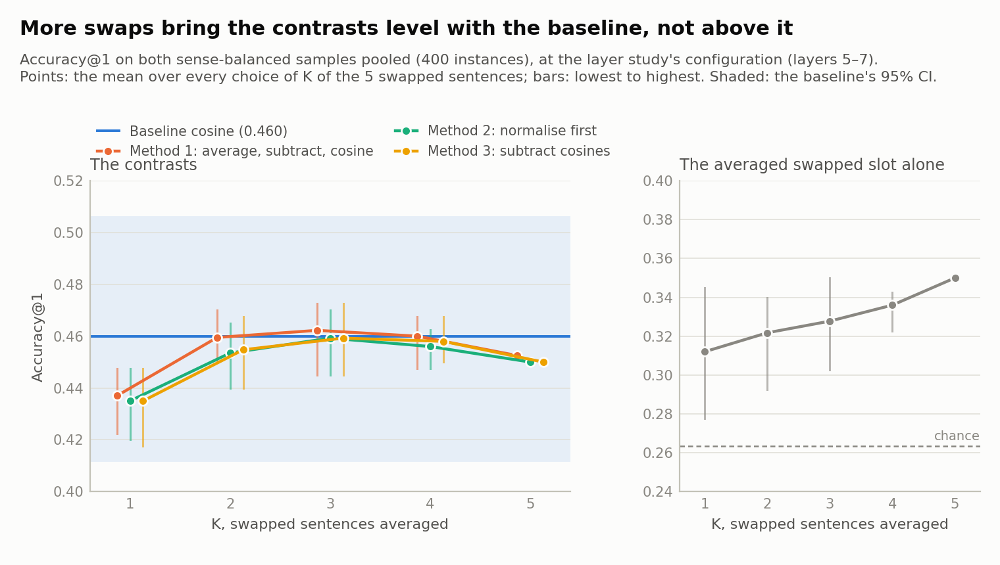

# Does averaging more swapped sentences make the swap contrast work?

> This follows on from [`SWAP_STUDY.md`](SWAP_STUDY.md) and was written on 7 November 2026. The swap study
> subtracted the vector of one or two "swapped" sentences, in which the target is replaced by a random word of the
> same part of speech. Here up to five swapped sentences per target are averaged, and the average is subtracted
> from the original sentence's vector. Everything is judged on **sense-balanced data**. All numbers come from
> [`Analysis/swap_draws_study.py`](../Analysis/swap_draws_study.py), with the raw output in
> [`swap_draws_study/results.json`](swap_draws_study/results.json). The scores are the swap study's, documented in
> [`Analysis/swap_methods.ipynb`](../Analysis/swap_methods.ipynb) (section 2 covers averaging several swaps).

## Summary

**The question.** A single random word is a noisy stand-in for "the grammatical slot": the swap study found that
two different random words could move sense-balanced accuracy by up to 0.08. Averaging K swapped sentences should
cancel the random words' own meanings and leave what the slot itself contributes. Draws 2–4 were extracted for the
400 targets of the two sense-balanced samples, which with the existing draws 0–1 gives five per target.

**Result: no signal.** At the layer study's configuration, with both balanced samples pooled (400 instances):

| Swaps averaged, K | 1 | 2 | 3 | 4 | 5 |
|---|---:|---:|---:|---:|---:|
| Method 1: average, subtract, then cosine | 0.437 | 0.460 | 0.462 | 0.460 | 0.453 |
| Method 2: normalise, average, subtract | 0.435 | 0.454 | 0.459 | 0.456 | 0.450 |
| Method 3: subtract the average cosine | 0.435 | 0.455 | 0.459 | 0.458 | 0.450 |
| Swapped slot alone | 0.312 | 0.322 | 0.328 | 0.336 | 0.350 |

Accuracy@1, averaged over every choice of K of the five swapped sentences. The baseline cosine scores **0.460**
[0.411, 0.506], and chance is 0.264.

- **One random word costs accuracy; averaging removes that cost.** With one swap, method 1 is 0.023 below the
  baseline. From two swaps on it is level with the baseline (0.453–0.462).
- **It never gets above the baseline.** The pre-specified test, method 1 with all five swaps, is −0.007
  [−0.045, +0.033] (p = 0.76). No K and no method differs significantly from the baseline (all p ≥ 0.39).
- **With each method's own layers chosen on dev_balanced,** method 1 with five swaps scores 0.490 on test_balanced
  against the baseline's 0.465. That is +0.025 [−0.025, +0.076], p = 0.41, at the same configuration as the
  baseline. It is within noise.

**Why it doesn't work.** Averaging does what it should to the slot: the random words' meanings cancel, so the
averaged slot points more and more along the target (cosine 0.35 with one swap, 0.47 with five, at layers 5–7). But
the averaged slot also gets better at picking the right sense *on its own*: 0.312 with one swap, 0.350 with five,
well above chance. The slot is not just grammar. The model's state at that position already reflects what the
context says should go there, including which sense fits. Subtracting the slot removes that evidence along with the
grammar, and the two cancel out.

**What this means.** The swap idea has now been tested with one, two and five random words, matched and unmatched
for inflection, on natural and sense-balanced text. It never beats the plain cosine. In a language model, the
position a word occupies carries contextual meaning as well as grammar, so subtracting it can't isolate the word's
sense. The metrics study ([`METRICS_STUDY.md`](METRICS_STUDY.md)) has the one cheap lead found so far,
standardising each dimension.

---

## 1. What was run

- **Extraction:** `extract --samples dev_balanced_200 test_balanced_200 --swaps pos:2-4`. That is three more random
  same-POS words for each of the 400 balanced targets, chosen by the swap study's seeded draw. Each draw took about
  13.5 minutes on its own (59 minutes in all, partly while another job shared the CPU).
- **Analysis:** [`Analysis/swap_draws_study.py`](../Analysis/swap_draws_study.py), about 3 minutes.
- **Figure:** [`Analysis/swap_draws_figures.py`](../Analysis/swap_draws_figures.py).

No new code was needed for the scores. `Processing/contrastive.py` already averages any number of swapped sentences
(method 1 averages the vectors, method 2 the unit vectors and method 3 the cosines).

## 2. Protocol

Fixed in the docstring of [`swap_draws_study.py`](../Analysis/swap_draws_study.py) before any result existed.

1. **Primary.** The layer study's frozen configuration (*echo_last* × mean gloss, layers 5–7). Nothing is tuned on
   balanced data, so dev_balanced and test_balanced are pooled (400 instances). For K = 1 to 5, using draws 0 to
   K−1, each method is compared with the baseline by a paired, sentence-clustered bootstrap. The primary question:
   does method 1 with K = 5 beat the baseline?
2. **Secondary: which words were drawn.** For each K, every subset of K of the five draws (5, 10, 10, 5 and 1
   subsets), with the mean, lowest and highest accuracy.
3. **Secondary: own selection, K = 5.** Each method's search on dev_balanced (372 configurations), frozen and scored
   on test_balanced, paired against the baseline's own dev_balanced winner.
4. **Geometry:** for each K, the centred cosine between the target and the averaged slot, and their length ratio.

The natural-text samples were not used: they have only draws 0 and 1.

## 3. Results

### 3.1 Accuracy as swaps are added



The pre-specified comparison uses draws 0 to K−1 for each K:

| K | Method 1 | Method 2 | Method 3 | Swapped slot alone |
|---|---|---|---|---:|
| 1 | 0.443 (−0.018 [−0.055, +0.023], p = 0.471) | 0.448 (−0.013 [−0.050, +0.030], p = 0.599) | 0.448 (−0.013 [−0.050, +0.030], p = 0.599) | 0.312 |
| 2 | 0.450 (−0.010 [−0.050, +0.032], p = 0.664) | 0.440 (−0.020 [−0.060, +0.023], p = 0.391) | 0.440 (−0.020 [−0.060, +0.023], p = 0.391) | 0.320 |
| 3 | 0.470 (+0.010 [−0.030, +0.053], p = 0.660) | 0.468 (+0.007 [−0.033, +0.050], p = 0.757) | 0.468 (+0.007 [−0.033, +0.050], p = 0.757) | 0.318 |
| 4 | 0.468 (+0.007 [−0.033, +0.048], p = 0.739) | 0.463 (+0.003 [−0.037, +0.043], p = 0.946) | 0.460 (+0.000 [−0.040, +0.042], p = 1.000) | 0.340 |
| 5 | 0.453 (−0.007 [−0.045, +0.033], p = 0.757) | 0.450 (−0.010 [−0.048, +0.030], p = 0.684) | 0.450 (−0.010 [−0.048, +0.030], p = 0.684) | 0.350 |

Accuracy@1, pooled, with the paired difference from the baseline (0.460) and its 95% CI.

Averaged over every choice of K draws, with the lowest and highest subset:

| K | Subsets | Method 1 | Method 2 | Method 3 | Swapped slot alone |
|---|---:|---|---|---|---|
| 1 | 5 | 0.437 [0.422, 0.448] | 0.435 [0.420, 0.448] | 0.435 [0.417, 0.448] | 0.312 [0.278, 0.345] |
| 2 | 10 | 0.460 [0.450, 0.470] | 0.454 [0.440, 0.465] | 0.455 [0.440, 0.468] | 0.322 [0.292, 0.340] |
| 3 | 10 | 0.462 [0.445, 0.472] | 0.459 [0.445, 0.470] | 0.459 [0.445, 0.472] | 0.328 [0.302, 0.350] |
| 4 | 5 | 0.460 [0.448, 0.468] | 0.456 [0.448, 0.463] | 0.458 [0.450, 0.468] | 0.336 [0.323, 0.343] |
| 5 | 1 | 0.453 | 0.450 | 0.450 | 0.350 |

- **The curve rises, then flattens at the baseline.** All five single swaps fall below the baseline (0.422–0.448).
  From K = 2 the contrasts sit within 0.01 of it, and the best subset of any size reaches 0.472.
- **The three methods agree.** Averaged over subsets, they are within 0.006 of each other at every K. Methods 2 and
  3 differ only through the band average.
- **Which words are drawn matters less as K grows.** The spread of the swapped slot's own accuracy narrows from
  0.067 (one swap) to 0.020 (four).

### 3.2 Each method's own layers, K = 5

| Score | Selected on dev_balanced | Dev acc@1 | Test acc@1 [95% CI] | vs baseline |
|---|---|---:|---|---|
| Baseline | echo_mean × mean gloss, layers 6–8 | 0.480 | **0.465** [0.395, 0.540] | |
| Method 1 | echo_mean × mean gloss, layers 6–8 | 0.470 | 0.490 [0.419, 0.562] | +0.025 [−0.025, +0.076], p = 0.407 |
| Method 2 | plain_last × mean gloss, layers 8–11 | 0.465 | 0.445 [0.377, 0.515] | −0.020 [−0.085, +0.045], p = 0.566 |
| Method 3 | echo_mean × mean gloss, layers 6–8 | 0.465 | 0.485 [0.415, 0.557] | +0.020 [−0.030, +0.070], p = 0.493 |

Methods 1 and 3 chose the baseline's own configuration and score 0.020–0.025 higher on test_balanced, but on dev
they were 0.010–0.015 *lower*. Differences of this size flip sign between the two 200-instance samples, so this is
noise.

### 3.3 What averaging does to the slot

Averages over the 400 balanced targets, read as *echo_last*. Both vectors are centred with the layer study's mean:

| Quantity, layers 5–7 | K = 1 | K = 2 | K = 3 | K = 4 | K = 5 |
|---|---:|---:|---:|---:|---:|
| cos(target, averaged slot) | 0.35 | 0.41 | 0.44 | 0.46 | 0.47 |
| length of averaged slot / length of target | 0.98 | 0.82 | 0.76 | 0.73 | 0.71 |
| accuracy of the averaged slot alone | 0.312 | 0.322 | 0.328 | 0.336 | 0.350 |

- **The random words' own meanings average away.** The averaged slot gets shorter, because the parts specific to
  each random word point in different directions and cancel. What remains points more along the target.
- **What remains carries sense information.** Scoring the glosses against the averaged slot alone, with no trace of
  the target word, gets steadily better with K: 0.350 with five swaps, against 0.264 for chance. The model's state
  at that position reflects what the context says should go there, including which meaning fits.
- **So subtracting it removes evidence as well as grammar.** The swap study found the same thing from another angle:
  the slot agreed with the baseline's pick more often when the baseline was right. As K grows, the subtracted
  vector holds more of both, and accuracy stays level.

### 3.4 Limitations

- **Sample size.** With 400 pooled instances, paired CIs are about ±0.04, so an effect of +0.02 would go unseen.
  Nothing here suggests one: the curve is flat from K = 2.
- **Rare words.** The replacements are drawn uniformly over distinct word forms, so most are rare words, as in the
  swap study. Frequency-matched replacements were not tried.
- **Five draws.** The averaged slot's own accuracy was still rising at K = 5, so more draws would carry even more
  context. Given the mechanism above, that would not be expected to help the contrast.

## 4. Reproducing

```bash
# from the repository root, in WSL
.venv/bin/python -u -m Processing.script extract --samples dev_balanced_200 test_balanced_200 --swaps pos:2-4
.venv/bin/python Analysis/swap_draws_study.py      # about 3 minutes; writes Report/swap_draws_study/results.json
.venv/bin/python Analysis/swap_draws_figures.py    # the figure, into Report/figures/
```

The swapped sentences are deterministic: draw j for a target is always the same word.
