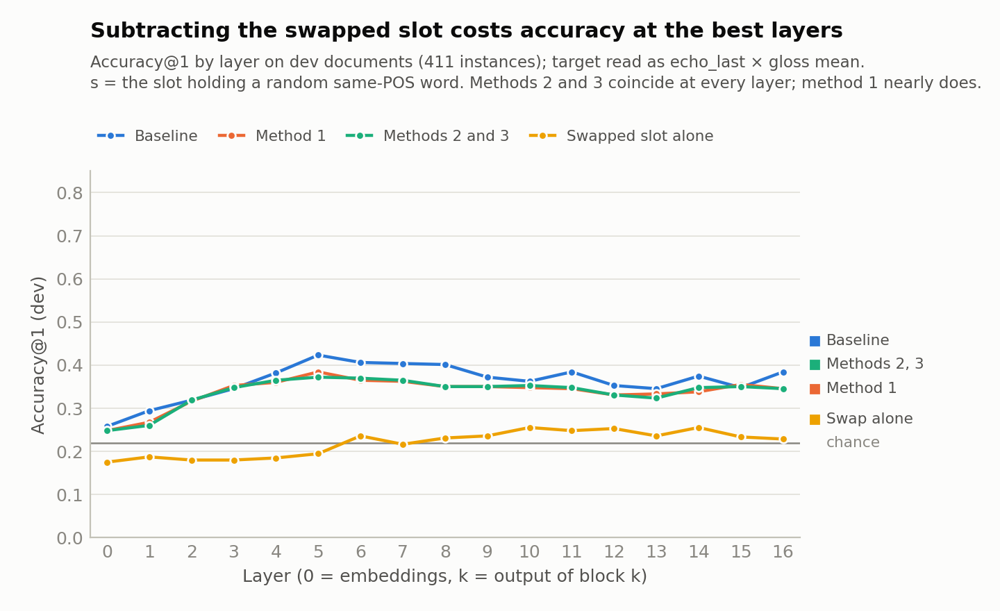
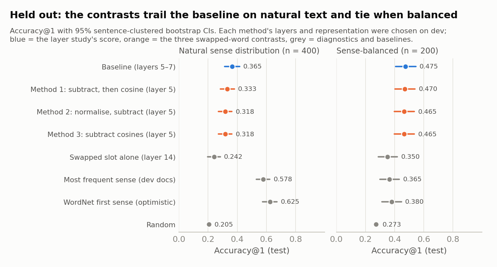
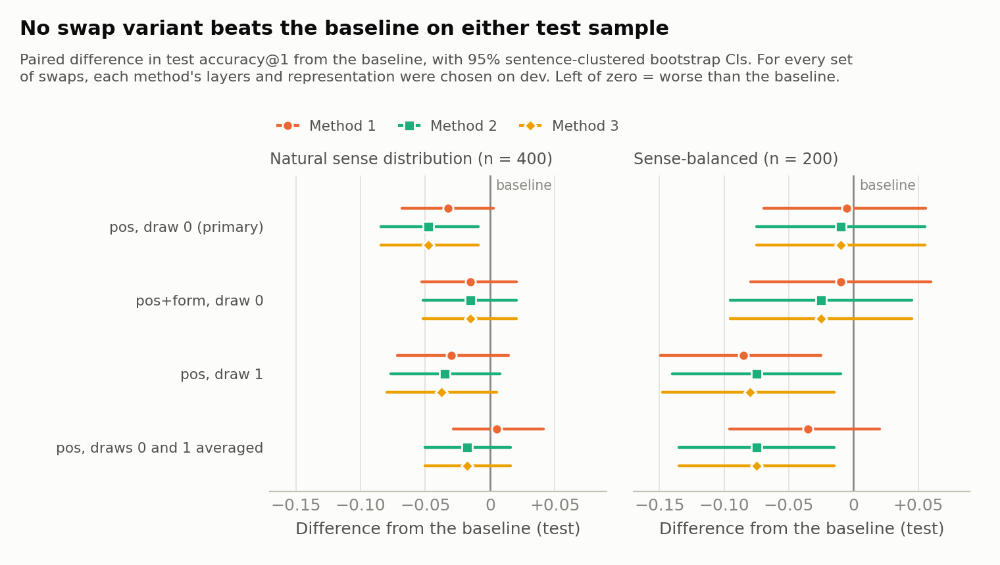
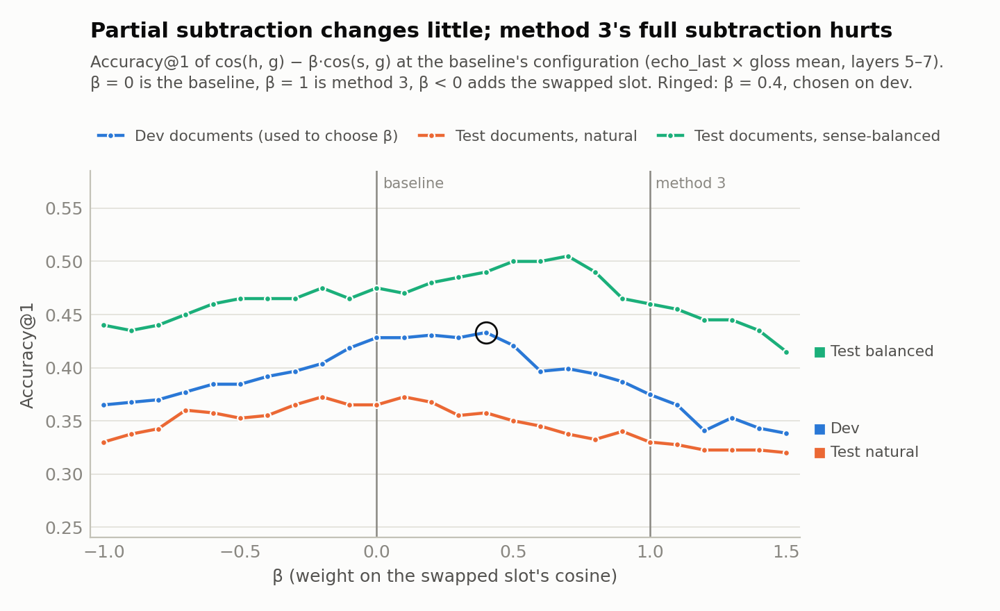

# Does a swapped-word control sharpen gloss matching?

> This follows on from [`LAYER_STUDY.md`](LAYER_STUDY.md) and was written on 7 November 2026. It tests whether
> contrasting a target word's hidden state with the same sentence holding a random word of the same part of speech
> strips out "grammatical" similarity and improves gloss matching. The data, layers, centring and protocol are the
> layer study's: every choice is made on **dev documents**, and the frozen choices are scored once on **held-out
> test documents**. All numbers come from [`Analysis/swap_study.py`](../Analysis/swap_study.py), with the raw output
> in [`swap_study/results.json`](swap_study/results.json). The maths of every function is worked through, with
> examples, in [`Analysis/swap_methods.ipynb`](../Analysis/swap_methods.ipynb).

## Summary

**The idea.** The cosine between a target word's vector $h$ and a gloss vector $g$ may mix two things: how close
the meanings are, and how similar the grammatical signals are (part of speech, syntactic role, position). Re-running
the sentence with the target swapped for a random word of the same part of speech gives a vector $s$ for the same
grammatical slot with a different meaning. Three ways of contrasting the two were tested:

1. $\cos(h - s,\ g)$: subtract the activations, then take the cosine.
2. $\cos(h/\lVert h\rVert - s/\lVert s\rVert,\ g)$: normalise, subtract, then take the cosine.
3. $\cos(h, g) - \cos(s, g)$: take the cosine with each, then subtract.

**Result: the contrasts do not help.** On held-out test documents, with each method's layers and representation
chosen on dev:

| Test sample | Baseline (layer study) | Method 1 | Methods 2 and 3 | Swapped slot alone |
|---|---:|---:|---:|---:|
| Natural sense distribution (400 instances) | **0.365** [0.313, 0.416] | 0.333 [0.285, 0.380] | 0.318 [0.271, 0.363] | 0.242 |
| Sense-balanced (200 instances) | **0.475** [0.408, 0.545] | 0.470 [0.402, 0.540] | 0.465 [0.397, 0.535] | 0.350 |

Accuracy@1 with 95% sentence-clustered bootstrap CIs. Chance is 0.205 (natural) and 0.273 (balanced).

- **Natural text: slightly worse.** Paired against the baseline, method 1 loses 0.033 (p = 0.10), and methods 2 and
  3 lose 0.048 (p = 0.013). Scored at the baseline's own layers, so that layer choice plays no part, all three lose
  0.035 (p = 0.07–0.09).
- **Sense-balanced text: no difference.** The changes are −0.005 to −0.010 (p ≥ 0.82).
- **Methods 2 and 3 are one method.** They provably rank the candidate senses identically at any single layer
  ([§2.2](#22-scores-and-how-they-relate)), and here they picked the same sense for every test instance. Method 1
  nearly coincides with them too. At these layers $h$ and $s$ have almost the same length (ratio 0.92–1.00), and
  method 1 is method 3 with each cosine weighted by its vector's length.
- **Better-controlled swaps narrow the gap but never open a lead** ([§3.4](#34-secondary-analyses)). On natural
  text, inflection-matched swaps and two averaged draws come closer to the baseline than a single random draw does.
  The best, method 1 on two averaged draws, is level with it (0.370 against 0.365, p = 0.87). On sense-balanced
  text, a second single draw loses 0.075–0.085 (p ≤ 0.03), so one random word is a noisy control. Of 56 test
  comparisons with the baseline, the 7 with p < 0.05 all favour the baseline.
- **Partial subtraction doesn't help either.** Subtracting only a fraction β of the slot's cosine, with β tuned on
  dev, gives β = 0–0.4 (close to no subtraction) and moves test accuracy by at most 0.015 either way (p ≥ 0.34).

**Why it doesn't help.**
- **The shared part is real.** At the best layers the swapped slot shares about a third of the target's direction:
  the centred cosine between $h$ and $s$ is 0.29–0.35 at layers 5–7.
- **It doesn't say which sense is right.** Scoring the glosses against the swapped slot alone is at chance on
  natural text at those layers (0.221 against 0.219 on dev, 0.210 against 0.205 on test).
- **Nor does it track the errors** (an exploratory check, [§3.3](#33-why-the-contrast-doesnt-help-diagnostics)).
  The slot's favourite sense matches the baseline's pick more often than chance (0.33 against 0.22 on dev), but not
  more often when the baseline is wrong: 0.33 when it is wrong against 0.34 when it is right on dev, and lower when
  wrong in all four samples.

Subtracting the slot therefore removes nothing that separates right picks from wrong ones, and it adds noise from
the random word's own similarity to each gloss. At the baseline's layers, method 3 changes the chosen sense for 41%
of dev instances: 55 of those changes break a correct pick and 33 fix a wrong one.

**What this means.** In this form, the data don't support the idea that grammatical similarity is a source of error.
Whatever the target shares with a same-POS stand-in doesn't favour the wrong senses. The errors most likely come
from elsewhere:
- **The gloss side.** Glosses are short definitions read with only the lemma as context.
- **Frequency.** On natural text the most frequent sense still wins, 0.578 against 0.365.

Next steps are in [§3.6](#36-limitations-and-next-steps).

---

## 1. What was built

| File | What it does |
|---|---|
| [`Processing/swaps.py`](../Processing/swaps.py) | Builds the swapped sentences: the replacement pool, the seeded random draw, capitalisation and clitic handling, one swap per candidate part of speech, the plan file and the model inputs. |
| [`Processing/contrastive.py`](../Processing/contrastive.py) | The scores: the baseline, methods 1–3, the swapped-slot diagnostic and the β family linking them. |
| [`Processing/script.py`](../Processing/script.py) | `estimate` and `extract` take `--swaps pos:0 pos+form:0 pos:1`. The vectors go to `Data/Processed/v2/activations/swapped_seed0/`, with every swapped sentence recorded in `plan.json`. |
| [`Analysis/swap_study.py`](../Analysis/swap_study.py) | The experiment (protocol in [§2.3](#23-protocol)). |
| [`Analysis/swap_study_figures.py`](../Analysis/swap_study_figures.py) | The four figures below. |
| [`Analysis/swap_methods.ipynb`](../Analysis/swap_methods.ipynb) | Every function documented, with hand-checkable examples and real Llama examples. It is generated by [`build_swap_notebook.py`](../Analysis/build_swap_notebook.py). |
| [`tests/test_swaps.py`](../tests/test_swaps.py), [`tests/test_contrastive.py`](../tests/test_contrastive.py) | 21 unit tests, including the notebook's identities. |

Nothing in the layer study's code path changed. `layer_study_figures.lines` gained an optional `colors` argument.

## 2. Method

### 2.1 Swapped sentences

Each evaluated target's sentence is run a second time with the target replaced:

- **Pool.** The replacement is drawn uniformly at random from the distinct surface forms of sense-tagged SemCor
  words with the same part of speech. That gives 10,995 nouns, 7,645 verbs, 4,687 adjectives and 1,197 adverbs.
  Only lower-case alphabetic single words are used, which excludes names, numbers and multiword expressions.
  Every form of the target's own lemma is excluded. Accidental synonyms are possible.
- **Text.** The replacement copies the target's capitalisation. A clitic target written against its neighbour,
  such as *'s* in *It's*, gets a space ("It disputed the old story").
- **One swap per part of speech.** Each candidate sense is compared against a slot holding a word of its own part
  of speech. In v2 every candidate shares the target's part of speech, so this means one swapped sentence per
  target per draw. The code also handles mixed candidate lists.
- **Determinism.** Each draw is seeded by (seed, target, part of speech, draw, mode), so it never depends on what
  else is in the run.
- **Vectors.** The swapped sentence goes through the same echo prompt and forward pass as the original. Its vector
  is read at the replacement's tokens in the same three ways (*plain_last*, *echo_last*, *echo_mean*).

Three sets of swaps were extracted for all 1,208 targets in the four samples. They took 39–52 minutes each on the
laptop CPU.

| Condition | Replacement | Role |
|---|---|---|
| `pos`, draw 0 | random word, same part of speech | **primary**: the design as specified |
| `pos+form`, draw 0 | random word, same part of speech and same inflection class | secondary |
| `pos`, draw 1 | a second random word, same rule | secondary: replication, and averaged with draw 0 |

`pos+form` reads a heuristic inflection class off the word and its lemma: plural noun; verb *-s*, *-ed*, *-ing* or
irregular; comparative or superlative adjective. A dev sentence shows the difference:

> Have you **considered delegating operational responsibility** to your employee **association** and carefully
> **restricting** your **plant**'s financial **contribution**?

| Target | `pos` draw 0 | `pos+form` draw 0 |
|---|---|---|
| considered | baptized | boycotted |
| delegating | escaped | postponing |
| operational | heterozygous | unshaven |
| responsibility | cocaine | university |
| association | look | banquet |
| restricting | permits | chaffing |
| plant | knight-errantry | programming |

POS-only matching can break the grammar ("Have you considered *escaped* operational responsibility"); `pos+form`
keeps it. Both pools are dominated by rare words, because the draw is uniform over distinct forms.

### 2.2 Scores and how they relate

Per layer, with $h$ = the target's vector, $s$ = the swapped slot's vector and $g_k$ = candidate $k$'s gloss vector.
All vectors are centred with the layer study's dev means, and $\hat x$ is a centred vector scaled to unit length.

| Score | Formula | Code |
|---|---|---|
| baseline | $\cos(h, g_k)$ | `baseline`, the layer study's score |
| method 1 | $\cos(h - s,\ g_k)$ | `diff` |
| method 2 | $\cos(\hat h - \hat s,\ g_k)$ | `normdiff` |
| method 3 | $\cos(h, g_k) - \cos(s, g_k)$ | `scorediff` |
| swapped slot alone | $\cos(s, g_k)$ | `swap`, a diagnostic: what the slot says without the word |

The highest score is predicted. Cosine distance ($1-\cos$, lowest first) gives the same ranking for every score. The
subtraction is always original minus swapped; the reverse order would reverse every ranking. A band of layers
averages the per-layer scores, as in the layer study.

Three facts follow from the algebra. The notebook proves each one and checks it to about $10^{-7}$ on real vectors.

1. **Methods 2 and 3 rank identically at any single layer.** With $d = \hat h - \hat s$, method 3 is
   $\langle d, \hat g_k\rangle$ and method 2 is $\langle d, \hat g_k\rangle/\lVert d\rVert$. $\lVert d\rVert$ is the
   same for every candidate. Over a band, method 3 weights layer $l$ by $\lVert d_l\rVert$, and the two can then
   differ. With the primary swaps they never differ at a single layer, and over the layer 5–7 band they differ for
   at most 0.5% of instances (1.5% with any set of swaps).
2. **Method 1 is method 3 with length weights.** It ranks like
   $\lVert h\rVert\cos(h,g_k) - \lVert s\rVert\cos(s,g_k)$, and the centring mean cancels out of $h - s$.
3. **All three lie on one line**, $\cos(h,g_k) - \beta\cos(s,g_k)$:
   - β = 0 is the baseline;
   - β = 1 is method 3, and method 2's ranking;
   - β = $\lVert s\rVert/\lVert h\rVert$ per target gives method 1's ranking.

   Tuning β on dev is a secondary analysis.

### 2.3 Protocol

The protocol was fixed in the docstring of [`swap_study.py`](../Analysis/swap_study.py) before any result existed.

1. **Primary.** For each score, the layer study's dev search was repeated on dev_natural: 3 target representations
   × 2 gloss representations × 62 contiguous bands of 1–4 layers, giving 372 configurations ranked by accuracy@1.
   Each score's winner was frozen and scored once on test_natural and test_balanced. Results carry
   cluster-bootstrap CIs and paired comparisons with the frozen baseline. The baseline's search reproduces the
   layer study exactly (*echo_last* × mean gloss, layers 5–7, test accuracy 0.365).
2. **Secondary.** These are reported whatever they show:
   - each method at the baseline's frozen configuration;
   - inflection-matched swaps;
   - a second random draw on its own;
   - the two draws averaged;
   - β tuned on dev (grid −1.0 to 1.5).
3. **Diagnostics.** The swapped slot's own accuracy by layer, the geometry of $h$ against $s$, and how often methods
   2 and 3 disagree.
4. **Exploratory**, added after the primary result was seen and labelled as such. Does the baseline's wrong pick
   coincide with the swapped slot's pick more often than chance?

## 3. Results

### 3.1 Dev: profiles and selection



| Score | Selected on dev | Dev acc@1 [95% CI] | Dev acc@1 at the baseline's configuration |
|---|---|---|---:|
| Baseline | echo_last × mean gloss, layers 5–7 | **0.428** [0.376, 0.477] | 0.428 |
| Method 1 | echo_mean × mean gloss, layer 5 | 0.392 [0.346, 0.439] | 0.380 |
| Method 2 | echo_mean × mean gloss, layer 5 | 0.389 [0.343, 0.437] | 0.372 |
| Method 3 | echo_mean × mean gloss, layer 5 | 0.389 [0.343, 0.437] | 0.375 |
| Swapped slot alone | echo_last × last gloss, layer 14 | 0.265 [0.221, 0.304] | 0.221 |

Accuracy@1 by layer on dev_natural, with the target read as *echo_last* and glosses as their mean:

| Score | L0 | L2 | L4 | L5 | L6 | L7 | L8 | L10 | L12 | L14 | L16 |
|---|---:|---:|---:|---:|---:|---:|---:|---:|---:|---:|---:|
| Baseline | 0.26 | 0.32 | 0.38 | **0.42** | 0.41 | 0.40 | 0.40 | 0.36 | 0.35 | 0.37 | 0.38 |
| Method 1 | 0.25 | 0.32 | 0.36 | 0.38 | 0.36 | 0.36 | 0.35 | 0.35 | 0.33 | 0.34 | 0.35 |
| Methods 2 and 3 | 0.25 | 0.32 | 0.36 | 0.37 | 0.37 | 0.36 | 0.35 | 0.35 | 0.33 | 0.35 | 0.35 |
| Swapped slot alone | 0.18 | 0.18 | 0.18 | 0.19 | 0.24 | 0.22 | 0.23 | 0.26 | 0.25 | 0.26 | 0.23 |
| Chance | 0.22 | 0.22 | 0.22 | 0.22 | 0.22 | 0.22 | 0.22 | 0.22 | 0.22 | 0.22 | 0.22 |

- **The contrasts track the baseline but stay below it.** They are level at the embeddings and early blocks
  (layers 0–3). They fall furthest behind exactly where the baseline is best: 0.37–0.38 against 0.42 at layer 5.
- **The middle layers still win.** All three still choose layer 5.
- **The swapped slot alone is weak everywhere.** It is below chance at layers 0–5 (0.18–0.19 against 0.22), and at
  or slightly above chance from layer 6 on (0.22–0.26), where the later layers carry more of the sentence into the
  slot.

### 3.2 Held-out validation



| Score | Natural (400) | vs baseline | Sense-balanced (200) | vs baseline |
|---|---|---|---|---|
| **Baseline** (layer study) | **0.365** [0.313, 0.416] | | **0.475** [0.408, 0.545] | |
| Method 1, own selection | 0.333 [0.285, 0.380] | −0.033 [−0.068, +0.003], p = 0.095 | 0.470 [0.402, 0.540] | −0.005 [−0.069, +0.056], p = 0.947 |
| Method 2, own selection | 0.318 [0.271, 0.363] | −0.048 [−0.084, −0.009], p = 0.013 | 0.465 [0.397, 0.535] | −0.010 [−0.075, +0.055], p = 0.821 |
| Method 3, own selection | 0.318 [0.271, 0.363] | −0.048 [−0.084, −0.009], p = 0.013 | 0.465 [0.397, 0.535] | −0.010 [−0.075, +0.055], p = 0.821 |
| Method 1 at the baseline's layers | 0.330 [0.281, 0.379] | −0.035 [−0.070, +0.000], p = 0.068 | 0.450 [0.385, 0.520] | −0.025 [−0.086, +0.035], p = 0.474 |
| Method 2 at the baseline's layers | 0.330 [0.280, 0.379] | −0.035 [−0.073, +0.003], p = 0.087 | 0.460 [0.395, 0.528] | −0.015 [−0.076, +0.045], p = 0.682 |
| Method 3 at the baseline's layers | 0.330 [0.280, 0.379] | −0.035 [−0.073, +0.003], p = 0.087 | 0.460 [0.395, 0.528] | −0.015 [−0.076, +0.045], p = 0.682 |
| Swapped slot alone, own selection | 0.242 [0.198, 0.284] | −0.122 | 0.350 [0.287, 0.419] | −0.125 |
| Swapped slot alone at the baseline's layers | 0.210 [0.175, 0.248] | −0.155 | 0.315 [0.250, 0.380] | −0.160 |
| Most frequent sense (dev documents) | 0.578 [0.531, 0.624] | +0.212 | 0.365 [0.299, 0.432] | −0.110 |
| WordNet first sense (optimistic) | 0.625 [0.573, 0.673] | +0.260 | 0.380 [0.313, 0.447] | −0.095 |
| Random | 0.205 [0.191, 0.219] | | 0.273 [0.257, 0.291] | |

Paired differences are cluster-bootstrap estimates (2,000 resamples of sentences). Six contrasts were compared with
the baseline on two test samples, so the one result below 0.05 (methods 2 and 3 on natural text, p = 0.013) should
be read with that multiplicity in mind. Its direction, though, matches every other comparison in the table. Mean
reciprocal rank tells the same story: natural 0.557 for the baseline against 0.546 (method 1) and 0.536 (methods 2
and 3); balanced 0.684 against 0.672 and 0.668.

### 3.3 Why the contrast doesn't help: diagnostics

**How much of the target's vector is slot?** These are averages over dev_natural targets of the cosine between $h$
and the swapped slot $s$, raw and after centring, and of their length ratio:

| Representation | Quantity | L0 | L2 | L4 | L5 | L6 | L7 | L8 | L10 | L12 | L14 | L16 |
|---|---|---:|---:|---:|---:|---:|---:|---:|---:|---:|---:|---:|
| echo_last | cos(h, s), raw | 0.03 | 0.30 | 0.42 | 0.47 | 0.52 | 0.54 | 0.56 | 0.64 | 0.67 | 0.74 | 0.88 |
| echo_last | cos(h, s), centred | 0.00 | 0.11 | 0.21 | 0.29 | 0.32 | 0.35 | 0.38 | 0.43 | 0.50 | 0.56 | 0.66 |
| echo_last | ‖s‖ / ‖h‖, centred | 1.09 | 1.02 | 0.96 | 0.96 | 0.99 | 0.99 | 1.00 | 1.00 | 0.98 | 0.97 | 1.00 |
| plain_last | cos(h, s), centred | 0.00 | 0.10 | 0.16 | 0.22 | 0.23 | 0.26 | 0.26 | 0.28 | 0.27 | 0.30 | 0.37 |
| echo_mean | cos(h, s), centred | 0.00 | 0.13 | 0.23 | 0.31 | 0.32 | 0.35 | 0.37 | 0.41 | 0.44 | 0.47 | 0.53 |

- **The slot's share of the vector grows with depth.** At the embeddings, $h$ and $s$ are unrelated (cosine 0.03).
  By the last block they are nearly the same vector (raw 0.88): the late layers encode the slot and its context
  more than the word.
- **At the best layers the slot is about a third.** At layers 5–7 the centred cosine is about 0.3. For
  *plain_last*, which sees only the left context, it is lower (0.22–0.26).
- **The lengths match.** The ratio is close to 1 (0.92–1.00 at layers 5–7 across the three representations),
  which is why method 1 behaves like method 3.

**Does the slot carry sense information?** Hardly, at the layers that matter:
- **Natural text:** the swapped slot alone is at chance at layers 5–7 (dev 0.221 against 0.219, test 0.210 against
  0.205).
- **Sense-balanced text:** it is a little above chance (test 0.315 against 0.273, dev 0.310 against 0.254). There,
  a lemma's senses come from different contexts, and the context alone helps slightly.

**Does the slot explain the baseline's errors?** This check is exploratory: it was added after the primary result
was seen. If grammatical similarity pulled the baseline towards wrong senses, its wrong picks would often be the
sense that the swapped slot alone prefers. Everything here uses the baseline's layers and the primary swaps.

| Sample | Baseline wrong | Slot agrees with baseline: when it is wrong | when it is right | by chance | Rank correlation | Method 3 changes the pick | Changes that fix / break |
|---|---:|---:|---:|---:|---:|---:|---:|
| dev natural | 235 of 411 | 0.33 | 0.34 | 0.22 | 0.25 | 41% | 33 / 55 |
| dev balanced | 111 of 200 | 0.35 | 0.45 | 0.25 | 0.29 | 32% | 15 / 17 |
| test natural | 254 of 400 | 0.30 | 0.37 | 0.21 | 0.22 | 43% | 29 / 43 |
| test balanced | 105 of 200 | 0.37 | 0.39 | 0.27 | 0.29 | 29% | 17 / 20 |

"Agrees" means the slot alone ranks the baseline's pick first. "By chance" is the average of 1/(number of
candidates). The rank correlation is Spearman's, between the baseline's and the slot's scores over a target's
candidates, averaged over targets with at least three candidates.

- **The slot and the target share something.** The slot's favourite sense is the baseline's pick more often than
  chance (0.30–0.45 against 0.21–0.27), and their rankings correlate (0.22–0.29).
- **But not the errors.** In every sample the slot agrees with the baseline less often when the baseline is wrong
  than when it is right. Subtracting the slot therefore takes support away from right picks at least as often as
  from wrong ones.
- **So subtraction can't target the errors.** Method 3 changes 29–43% of picks, and in every sample more of those
  changes break a correct pick than fix a wrong one.

**Methods 2 and 3.** The identity holds on real data. With the primary swaps the two picked different senses for no
instance at any single layer, on all four samples, and for 0–0.5% of instances over the layer 5–7 band (up to 1.5%
with the secondary swaps).

### 3.4 Secondary analyses

Each set of swaps gets its own dev search for each method, as in the primary analysis. Every row is compared with
the same frozen baseline (0.365 natural, 0.475 balanced).



| Swaps | Method | Selected on dev | Dev | Natural test | vs baseline | Balanced test | vs baseline |
|---|---|---|---:|---:|---|---:|---|
| `pos`, draw 0 (primary) | 1 | echo_mean × mean gloss, layer 5 | 0.392 | 0.333 | −0.033 [−0.068, +0.003], p = 0.095 | 0.470 | −0.005 [−0.069, +0.056], p = 0.947 |
| | 2 | echo_mean × mean gloss, layer 5 | 0.389 | 0.318 | −0.048 [−0.084, −0.009], p = 0.013 | 0.465 | −0.010 [−0.075, +0.055], p = 0.821 |
| | 3 | echo_mean × mean gloss, layer 5 | 0.389 | 0.318 | −0.048 [−0.084, −0.009], p = 0.013 | 0.465 | −0.010 [−0.075, +0.055], p = 0.821 |
| `pos+form`, draw 0 | 1 | echo_mean × mean gloss, layer 5 | 0.418 | 0.350 | −0.015 [−0.053, +0.021], p = 0.454 | 0.465 | −0.010 [−0.079, +0.060], p = 0.847 |
| | 2 | echo_mean × mean gloss, layer 5 | 0.409 | 0.350 | −0.015 [−0.052, +0.020], p = 0.456 | 0.450 | −0.025 [−0.095, +0.045], p = 0.529 |
| | 3 | echo_mean × mean gloss, layer 5 | 0.409 | 0.350 | −0.015 [−0.052, +0.020], p = 0.456 | 0.450 | −0.025 [−0.095, +0.045], p = 0.529 |
| `pos`, draw 1 | 1 | echo_mean × mean gloss, layers 4–5 | 0.404 | 0.335 | −0.030 [−0.071, +0.015], p = 0.219 | 0.390 | −0.085 [−0.149, −0.025], p = 0.007 |
| | 2 | echo_mean × mean gloss, layers 3–6 | 0.406 | 0.330 | −0.035 [−0.077, +0.007], p = 0.124 | 0.400 | −0.075 [−0.140, −0.010], p = 0.026 |
| | 3 | echo_mean × mean gloss, layers 3–6 | 0.404 | 0.328 | −0.037 [−0.080, +0.005], p = 0.096 | 0.395 | −0.080 [−0.148, −0.015], p = 0.015 |
| `pos`, draws 0 and 1 averaged | 1 | echo_mean × mean gloss, layers 5–6 | 0.426 | 0.370 | +0.005 [−0.028, +0.041], p = 0.869 | 0.440 | −0.035 [−0.095, +0.020], p = 0.259 |
| | 2 | echo_last × mean gloss, layer 5 | 0.418 | 0.347 | −0.018 [−0.050, +0.016], p = 0.326 | 0.400 | −0.075 [−0.135, −0.015], p = 0.016 |
| | 3 | echo_last × mean gloss, layer 5 | 0.418 | 0.347 | −0.018 [−0.050, +0.016], p = 0.326 | 0.400 | −0.075 [−0.135, −0.015], p = 0.016 |
| Baseline | | echo_last × mean gloss, layers 5–7 | 0.428 | 0.365 | | 0.475 | |

Scored at the baseline's own layers (*echo_last* × mean gloss, layers 5–7), which takes the layer choice out of the
comparison:

| Swaps | Natural test, methods 1 / 2 / 3 | Balanced test, methods 1 / 2 / 3 |
|---|---|---|
| `pos`, draw 0 (primary) | 0.330 / 0.330 / 0.330 | 0.450 / 0.460 / 0.460 |
| `pos+form`, draw 0 | 0.352 / 0.338 / 0.343 | 0.480 / 0.480 / 0.480 |
| `pos`, draw 1 | 0.352 / 0.355 / 0.352 | 0.430 / 0.420 / 0.420 |
| `pos`, draws 0 and 1 averaged | 0.367 / 0.367 / 0.367 | 0.470 / 0.460 / 0.460 |
| Baseline | 0.365 | 0.475 |

- **Matching the inflection helps, but only up to the baseline.** It shrinks the natural-text loss from
  0.033–0.048 to 0.015 (p ≈ 0.45). On dev it brings the contrasts within 0.01–0.02 of the baseline (0.409–0.418
  against 0.428). A stand-in that keeps the sentence grammatical is a closer control, but it still produces no gain.
- **A single random word is a noisy control.** The second draw repeats the natural-text loss (−0.030 to −0.037).
  On sense-balanced text it loses 0.075–0.085 (p = 0.007–0.026), where draw 0 tied. Which word happens to be drawn
  moves balanced accuracy by up to 0.08, more than the three methods differ from each other. At the baseline's
  layers, draw 1 comes about as close on natural text as the inflection-matched swaps, so part of the `pos+form`
  improvement may also be the luck of the draw.
- **Averaging two draws does best, and reaches the baseline.** Method 1 is level with it on natural text (0.370
  against 0.365, p = 0.87). At the baseline's layers all three contrasts are within 0.015 of the baseline on both
  test samples. Methods 2 and 3 chose a single layer on dev (*echo_last*, layer 5) that holds up poorly on balanced
  text (0.400, p = 0.016).
- **Methods 2 and 3 still coincide.** They chose the same configuration for every set of swaps. Only with draw 1,
  whose winner is a four-layer band, do their scores differ, by at most 0.005.

**Partial subtraction.** The score $\cos(h, g_k) - \beta\cos(s, g_k)$ was evaluated at the baseline's
configuration for β from −1 to 1.5 in steps of 0.1. β was chosen on dev, with ties going to the β nearest 0.



| Swaps | β chosen on dev | Dev | Natural test | vs baseline | Balanced test | vs baseline |
|---|---:|---:|---:|---|---:|---|
| `pos`, draw 0 (primary) | 0.4 | 0.433 | 0.357 | −0.007 [−0.030, +0.015], p = 0.568 | 0.490 | +0.015 [−0.025, +0.055], p = 0.548 |
| `pos+form`, draw 0 | 0.1 | 0.433 | 0.372 | +0.007 [−0.005, +0.021], p = 0.343 | 0.465 | −0.010 [−0.035, +0.020], p = 0.588 |
| `pos`, draw 1 | 0 | 0.428 | 0.365 | the baseline itself | 0.475 | the baseline itself |
| `pos`, draws 0 and 1 averaged | 0.2 | 0.438 | 0.370 | +0.005 [−0.011, +0.022], p = 0.693 | 0.480 | +0.005 [−0.025, +0.035], p = 0.884 |

- **On dev the curve is flat near zero.** In every set of swaps, dev accuracy stays within 0.02 of the baseline for
  β between 0 and 0.5, and falls beyond. Full subtraction (β = 1, which is method 3) costs 0.04–0.05 on dev in
  every set. Adding the slot instead (β < 0) also hurts.
- **The tuned β is small** (0–0.4), and it moves test accuracy by at most 0.015 either way. For draw 1, dev picks
  β = 0, which is the baseline itself.
- **Sense-balanced test text rises to 0.500–0.505 at β = 0.5–0.7 with the primary swaps.** The balanced dev documents
  don't show the same rise (0.445 to at most 0.455). With draw 1 it falls instead, to 0.420 at β = 1. This is
  noise, not a hidden gain.

### 3.5 By part of speech

The test sets are split by the target's part of speech. Each method uses its own dev selection and the primary
swaps. This is descriptive only, and the adjective and adverb cells are small.

| Natural test | adjective (n = 28) | noun (n = 154) | adverb (n = 19) | verb (n = 199) |
|---|---:|---:|---:|---:|
| Baseline | 0.321 | **0.468** | 0.316 | **0.296** |
| Method 1 | 0.393 | 0.422 | 0.421 | 0.246 |
| Methods 2 and 3 | 0.393 | 0.390 | 0.421 | 0.241 |

| Balanced test | adjective (n = 34) | noun (n = 98) | adverb (n = 14) | verb (n = 54) |
|---|---:|---:|---:|---:|
| Baseline | 0.471 | 0.459 | 0.571 | 0.481 |
| Method 1 | 0.471 | 0.439 | 0.500 | 0.519 |
| Methods 2 and 3 | 0.500 | 0.429 | 0.500 | 0.500 |

On natural text the loss comes from nouns and verbs, which are 88% of the instances. Adjectives and adverbs move
the other way, but on 28 and 19 instances that is within noise. Nothing here points to a part of speech where the
contrast reliably helps. Verbs might have been expected to benefit most, since they carry the richest grammatical
marking (tense, agreement), but they don't.

### 3.6 Limitations and next steps

**Limitations.**
- **Sample size.** The samples are small: 400 and 200 test instances, with the natural set drawn from 80
  sentences. CIs are about ±0.05, so a 0.02–0.03 effect in either direction would go unseen. The direction is
  consistent, though: across 56 test comparisons, no contrast or β variant beat the baseline by more than 0.015,
  and all 7 with p < 0.05 favour the baseline.
- **Rare replacements.** The draw is uniform over distinct forms, so most replacements are rare words
  (*heterozygous*, *knight-errantry*). Their representations may be less typical stand-ins for the slot than common
  words would be.
- **Few draws.** One random word per target (two at most) gives a noisy estimate of "the slot". The two draws
  differ by up to 0.08 on balanced text, and averaging them did best (§3.4), so more draws would estimate the slot
  better.
- **Scope.** The test covers one model and one prompt format, and the contrast is applied only to the sentence
  side; glosses were not changed.

**Next steps**, given what the diagnostics show:
1. **Don't pursue the sentence-side swap further in this form.** The better-controlled versions (matched
   inflection, two draws averaged) only brought the contrasts level with the baseline. The β chosen on dev stayed
   between 0 and 0.4, close to no subtraction at all.
2. **Try the contrast on the gloss side instead (cheap: no new extraction).** All of a lemma's definition prompts
   start with the same "lemma:" prefix, so their vectors share a lemma component. Subtracting the mean of the
   candidates' gloss vectors before the cosine removes what the senses have in common. That is the analogue of your
   idea where the error more plausibly lies, and it needs only the vectors already cached. **Since tried:** it
   doesn't help either. See [`GLOSS_MEAN_STUDY.md`](GLOSS_MEAN_STUDY.md).
3. **Supervised sense centroids** remain the most promising step ([`LAYER_STUDY.md` §3.7](LAYER_STUDY.md#37-limitations-and-next-steps)).
   They replace glosses with the average vector of labelled dev examples of each sense, and they address the
   frequency gap directly.
4. **If you want to give the swap hypothesis a fuller test,** build on the two things that narrowed the gap here:
   matched inflection and averaging. Use replacements that match the target's inflection and frequency band, with
   5–10 draws per target. Each draw costs 40–50 minutes on this CPU for the four samples.

## 4. Reproducing

```bash
# from the repository root, in WSL
.venv/bin/python -u -m Processing.script extract --samples dev_natural_80 dev_balanced_200 test_natural_80 \
    test_balanced_200 --swaps pos:0 pos+form:0 pos:1   # 40–50 minutes per swap set
.venv/bin/python Analysis/swap_study.py                 # about 10 minutes; writes Report/swap_study/results.json
.venv/bin/python Analysis/swap_study_figures.py         # the four figures, into Report/figures/
.venv/bin/python Analysis/build_swap_notebook.py && \
    (cd Analysis && ../.venv/bin/jupyter nbconvert --to notebook --execute --inplace swap_methods.ipynb)
.venv/bin/python -m tests.run_tests swaps contrastive   # the 21 new tests
```

The swapped sentences are deterministic, so a re-run reproduces every number. JAX prints a warning about an NVIDIA
GPU; it is a false alarm, because this laptop has only Intel HD 520 graphics.
